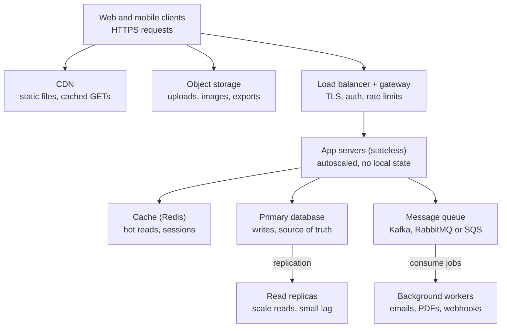

# Developer Interview Prep Guide

Nov 1, 2026

## Contents

- [How to use this guide](#how-to-use-this-guide)
- [Which tabs to study for your role](#which-tabs-to-study-for-your-role)
- [How to answer like a strong candidate](#how-to-answer-like-a-strong-candidate)
- [A 3-week preparation plan](#a-3-week-preparation-plan)
- [Sources](#sources)
- Question banks
  1. [JavaScript](#javascript)
  2. [TypeScript](#typescript)
  3. [React](#react)
  4. [Angular](#angular)
  5. [Vue](#vue)
  6. [Node.js and Express](#nodejs-and-express)
  7. [Java and Spring Boot](#java-and-spring-boot)
  8. [Python, Django and FastAPI](#python-django-and-fastapi)
  9. [SQL and databases](#sql-and-databases)
  10. [Web security](#web-security)
  11. [System design and architecture](#system-design-and-architecture)
  12. [DevOps: Docker, Kubernetes, CI/CD, Terraform, cloud](#devops-docker-kubernetes-cicd-terraform-cloud)
  13. [Coding rounds](#coding-rounds)
  14. [Behavioral, managerial and HR rounds](#behavioral-managerial-and-hr-rounds)

## How to use this guide

This guide holds about 400 real interview questions, each with an answer written the way a strong candidate would say it out loud. The questions are drawn from interview-experience reports (Glassdoor, AmbitionBox, Naukri Code360, Medium, 2023 to 2026), widely used question banks, and the post you shared.

- **One section per topic.** Each topic (JavaScript, React, Node.js, Java, DevOps and so on) is its own section below. Study the sections your role needs (next section).
- **Level tags.** Every question is marked **[J]** Junior (0–2 yrs), **[M]** Mid (2–5 yrs) or **[S]** Senior (5+ yrs). Juniors can stop at [J] and [M]; seniors should be fluent in all three, because interviewers start easy and drill down.
- **Answer shape.** Each answer starts with a one-line definition you can say in 10 seconds, then the detail, a code snippet where it helps, and often a *Follow-up* the interviewer is likely to ask next.
- **What changed recently.** Interviews in 2025–26 lean on scenario questions ("10,000 rows are slow, what do you do?") and on newer features: React 19 Actions and Server Components, Angular Signals and zoneless change detection, Vue 3 Composition API, Java 21 virtual threads. Those are covered.
- **Make it yours.** Add your own project example under any answer. An answer tied to your own work beats a perfect textbook answer.

## Which tabs to study for your role

Every role gets JavaScript-or-language basics, SQL, Security and Behavioral; the rest depends on the stack. "Core" means expect deep questions; "Light" means a few questions, usually scenario-based.

| Role | Core sections | Light sections |
| --- | --- | --- |
| Full-stack (React + Node) | JavaScript, React, Node.js, SQL, Coding rounds | TypeScript, Security, System design, DevOps, Behavioral |
| Frontend (React) | JavaScript, React, TypeScript, Coding rounds | Security (XSS, CSRF, CORS), System design (frontend), Behavioral |
| Frontend (Angular) | JavaScript, TypeScript, Angular, Coding rounds | Security, System design, Behavioral |
| Frontend (Vue) | JavaScript, Vue, TypeScript, Coding rounds | Security, System design, Behavioral |
| Backend (Node.js) | JavaScript, Node.js, SQL, System design | TypeScript, Security, DevOps, Coding rounds, Behavioral |
| Backend (Java / Spring Boot) | Java, SQL, System design | Security, DevOps, Coding rounds, Behavioral |
| Backend (Python / Django / FastAPI) | Python, SQL, System design | Security, DevOps, Coding rounds, Behavioral |
| DevOps / Cloud | DevOps, System design | Python or shell basics, Security, Behavioral |
| JavaScript / TypeScript specialist | JavaScript, TypeScript, Coding rounds | Node.js or React (whichever the job uses), Behavioral |

Senior candidates at any role: System design and Behavioral move from "Light" to "Core".

## How to answer like a strong candidate

Use four beats for every technical answer: **define, show, trade-off, experience.** It takes 60–90 seconds and signals seniority without rambling.

1. **Define** in one sentence. "Hoisting is JavaScript moving declarations to the top of their scope during compilation."
2. **Show** a tiny example or the mechanism. "So `var x` is `undefined` before its line, but `let x` throws because it's in the temporal dead zone."
3. **Trade-off or pitfall.** "That's why we use `let`/`const`: bugs show up as errors instead of silent `undefined`."
4. **Experience.** "In our checkout code a `var` inside a loop captured the last index; switching to `let` fixed it."

A few rules that separate a good answer from an average one:

- **Don't stop at the definition.** Interviewers in these reports keep saying they want scenarios, not recitations. Always add "when I'd use it" or "what breaks".
- **Say "it depends" only with the dependency.** "It depends on read/write ratio: read-heavy, I'd add a cache; write-heavy, I'd shard."
- **Admit gaps cleanly.** "I haven't used Kafka in production, but I've used RabbitMQ; the difference I know is…" scores better than bluffing.
- **Think aloud in coding rounds.** State the brute force, its complexity, then improve. Silence is the most common reason good coders fail.
- **Behavioral answers use STAR** (Situation, Task, Action, Result) with a number in the result: "cut p95 latency from 1.2 s to 300 ms."

## A 3-week preparation plan

About 2 hours a day on weekdays and 4 on weekends is enough to cover your core sections twice.

1. **Week 1 – Fundamentals.** Your language section (JavaScript, Java or Python) and SQL. Read each answer, close the doc, and say it aloud. Do 1–2 easy coding problems daily from the Coding rounds section.
2. **Week 2 – Framework and backend depth.** Your framework section (React, Angular, Vue, Node, Spring or Django/FastAPI) plus Security. Build one small feature from scratch without a tutorial (a debounced search, a paginated API, an RBAC route guard). Do 1 medium coding problem daily.
3. **Week 3 – Seniority and polish.** System design (draw two designs end-to-end), DevOps basics, and Behavioral. Write your 5 STAR stories. Do two mock interviews with a friend or record yourself answering 10 random questions.
4. **Night before.** Skim only the one-line definitions in your core sections, re-read your STAR stories, and prepare 2 questions to ask the interviewer.

If you have only one week, do the [M] questions in your core sections, the output-prediction questions in Coding rounds, and your STAR stories.

## Sources

LinkedIn itself blocks automated reading, so the question list was built from public interview reports and question banks, plus the post you shared. Answers are written for this guide; check version-specific details (React 19, Angular 20, Java 21, Python 3.14) against official docs before an interview.

- [Glassdoor: UKG Senior DevOps Engineer interview reports](https://www.glassdoor.co.in/Interview/UKG-Interview-E7900-RVW98149573.htm) (Kubernetes, Terraform, GitHub Actions, Linux, puzzles)
- [GoLinuxCloud: Node.js developer interview questions, 2026](https://www.golinuxcloud.com/node-js-developer-interview-questions/) (event loop, streams, scaling, senior expectations)
- [GreatFrontEnd: 100+ React interview questions from ex-interviewers](https://www.greatfrontend.com/blog/100-react-interview-questions-straight-from-ex-interviewers) (React 19, hooks, performance)
- [Glassdoor: Capgemini Senior Angular Developer reports](https://clear.glassdoor.nl/Interview/Capgemini-Interview-E3803-RVW99138989.htm) (directives, lazy loading, 10,000-row table scenario)
- [Glassdoor: Infosys DevOps Engineer reports](https://www.glassdoor.com.au/Interview/Infosys-Interview-E7927-RVW98425993.htm) (CI/CD, Kubernetes, AWS, Terraform)
- [AmbitionBox: Perficient DevOps Engineer interviews](https://www.ambitionbox.com/interviews/perficient-interview-questions/devops-engineer) (scenario-based Docker and Kubernetes)
- [Naukri Code360: full-stack intern interview experiences](https://www.naukri.com/code360/interview-experiences/augenblick-consulting/interview-experience-off-campus-oct-2023-8903) (React, Node, JavaScript MCQs, reverse words)
- [Glassdoor: PureCode Software React and Node.js reports](https://www.glassdoor.com.mx/Entrevista/PureCode-Software-Entrevista-E8122561-RVW89013549.htm) (event loop, middleware, SQL vs NoSQL)
- [Medium: Real Java backend interview at TCS](https://medium.com/javaguides/real-java-backend-developer-interview-at-tcs-questions-answers-spring-boot-microservices-67ad72ff3190) (Core Java, Spring Boot, microservices)
- [DataCamp: FastAPI interview questions](https://www.datacamp.com/blog/fastapi-interview-questions) (validation, dependency injection, async)
- [GreatFrontEnd: Vue.js interview questions 2026](https://www.greatfrontend.com/blog/vue-interview-questions) (reactivity, composables)
- [GoLinuxCloud: Angular developer interview questions](https://www.golinuxcloud.com/angular-developer-interview-questions/) (signals, zoneless, RxJS operators)
- [GoLinuxCloud: TypeScript interview questions](https://www.golinuxcloud.com/typescript-interview-questions/) (generics, utility types, satisfies)


---

# JavaScript

JavaScript questions open almost every frontend, full-stack and Node.js round. The most-asked five in recent reports: event loop, closures, `this`, promises, and hoisting.

## Core language

### 1. What is hoisting? [J]

Hoisting is the engine registering declarations at the top of their scope before code runs. `var` declarations are hoisted and initialised to `undefined`; function declarations are hoisted with their body; `let`, `const` and `class` are hoisted but **not initialised**, so touching them before their line throws a `ReferenceError`. That gap is the **temporal dead zone (TDZ)**.

```js
console.log(a); // undefined
var a = 1;
console.log(b); // ReferenceError (TDZ)
let b = 2;
sayHi();        // works: function declarations are fully hoisted
function sayHi() { console.log('hi'); }
```

*Follow-up:* function expressions (`const f = function(){}`) behave like the variable they're assigned to, so they're not callable before the line.

### 2. `var` vs `let` vs `const` [J]

| | var | let | const |
| --- | --- | --- | --- |
| Scope | Function | Block | Block |
| Re-declare in same scope | Yes | No | No |
| Re-assign | Yes | Yes | No |
| Before declaration | `undefined` | TDZ error | TDZ error |
| Creates `window` property at top level | Yes | No | No |

`const` stops re-assignment, not mutation: `const arr = []; arr.push(1)` is fine. Use `const` by default, `let` when you must re-assign, never `var` in new code.

### 3. `==` vs `===` [J]

`===` compares type and value with no conversion. `==` converts types first (`'5' == 5` is `true`, `null == undefined` is `true`, `0 == ''` is `true`). Always use `===`; the one accepted exception is `x == null` to check for both `null` and `undefined`.

### 4. `null` vs `undefined` [J]

`undefined` means a value was never assigned (missing property, missing argument, declared variable). `null` is an intentional "no value" that a developer sets. `typeof undefined` is `'undefined'`; `typeof null` is `'object'` (a historic bug).

### 5. What are the data types in JavaScript? [J]

Seven primitives: `string`, `number`, `bigint`, `boolean`, `undefined`, `null`, `symbol`. Everything else is an `object` (arrays, functions, dates, maps). Primitives are copied by value and immutable; objects are copied by reference.

*Classic trick:* `typeof NaN` is `'number'`, and `NaN === NaN` is `false`. Use `Number.isNaN(x)`.

### 6. Truthy and falsy values [J]

Falsy: `false`, `0`, `-0`, `0n`, `''`, `null`, `undefined`, `NaN`. Everything else is truthy, including `'0'`, `'false'`, `[]` and `{}`. This is why `count && <Badge/>` renders `0` in React.

### 7. Shallow copy vs deep copy [M]

A shallow copy duplicates the top level only; nested objects are still shared. Spread (`{...obj}`), `Object.assign` and `arr.slice()` are shallow. A deep copy duplicates everything.

```js
const deep = structuredClone(original); // modern, handles Dates, Maps, cycles
```

`JSON.parse(JSON.stringify(x))` also deep-copies but drops functions, `undefined`, and turns Dates into strings.

### 8. Spread vs rest [J]

Same `...` syntax, opposite jobs. **Spread** expands: `Math.max(...nums)`, `{...a, ...b}`. **Rest** collects: `function sum(...args)`, `const [first, ...others] = arr`.

### 9. Optional chaining and nullish coalescing [J]

`user?.address?.city` returns `undefined` instead of throwing if any link is `null`/`undefined`. `a ?? b` returns `b` only when `a` is `null` or `undefined`, unlike `||`, which also replaces `0` and `''`. So `count ?? 10` keeps a real `0`.

## Functions, scope and `this`

### 10. What is a closure? [J]

A closure is a function that remembers the variables of the scope where it was created, even after that scope has finished running.

```js
function counter() {
  let count = 0;
  return () => ++count;
}
const next = counter();
next(); // 1
next(); // 2  – count survives between calls
```

**Real uses:** data privacy (module pattern), memoisation, debounce/throttle, React hooks (each render's handlers close over that render's state). **Pitfall:** closures keep references alive, so a closure holding a large object can cause a memory leak.

### 11. What is a recursive function? [J]

A function that calls itself to solve a smaller copy of the same problem. It needs a **base case** that stops the recursion, or it hits "Maximum call stack size exceeded".

```js
function factorial(n) {
  if (n <= 1) return 1;      // base case
  return n * factorial(n - 1);
}
```

Good fits: trees (DOM, file systems, nested comments), flattening nested arrays, divide-and-conquer sorts. For very deep input, convert to a loop with an explicit stack.

### 12. How does `this` work? [M]

`this` is decided by **how a function is called**, not where it's written:

1. `new Fn()` → the new object.
2. `fn.call(obj)` / `apply` / `bind` → `obj`.
3. `obj.method()` → `obj`.
4. Plain `fn()` → `undefined` in strict mode (or `window` in sloppy mode).
5. **Arrow functions** have no own `this`; they use `this` from the surrounding scope.

```js
const user = {
  name: 'Asha',
  greet() { setTimeout(() => console.log(this.name), 0); } // 'Asha' – arrow keeps this
};
```

### 13. `call` vs `apply` vs `bind` [J]

All three set `this`. `call(thisArg, a, b)` runs now with arguments listed; `apply(thisArg, [a, b])` runs now with an array; `bind(thisArg, a)` returns a **new function** to run later. Memory aid: **A**pply = **A**rray.

### 14. Arrow functions vs regular functions [J]

Arrow functions have no own `this`, `arguments`, or `prototype`, and can't be used with `new`. Use them for callbacks; use regular functions for object methods that need `this` and for constructors.

### 15. What is a constructor in JavaScript? [J]

A constructor is a function called with `new` to create objects of one shape. `new` does four things: creates an empty object, links its prototype to `Constructor.prototype`, runs the function with `this` set to that object, and returns it (unless the function returns another object).

```js
function Car(make) { this.make = make; }
Car.prototype.drive = function () { return `${this.make} drives`; };
const c = new Car('Tata');

class Bike {               // same thing, class syntax
  constructor(make) { this.make = make; }
}
```

### 16. What is an IIFE and why was it used? [J]

An Immediately Invoked Function Expression runs as soon as it's defined: `(function () { ... })();`. Before ES modules and `let`, it was the way to create a private scope and avoid polluting globals.

### 17. What is currying? [M]

Turning `f(a, b, c)` into `f(a)(b)(c)`. It enables partial application: `const add = a => b => a + b; const add5 = add(5);`. Common in functional utilities and middleware factories like `authorize('admin')`.

### 18. Higher-order functions [J]

A function that takes a function as an argument or returns one. `map`, `filter`, `reduce`, `setTimeout`, and `debounce` are all higher-order. They are the JS basis of React's higher-order components.

### 19. `map` vs `forEach` vs `filter` vs `reduce` [J]

`map` returns a new array of transformed items; `forEach` returns nothing (side effects only); `filter` returns items that pass a test; `reduce` folds the array into one value (sum, object, grouped map). None of them mutate the original array.

## Objects, prototypes and classes

### 20. What is prototypal inheritance? [M]

Every object has a hidden link (`[[Prototype]]`) to another object. When a property isn't found on the object, JS walks up this **prototype chain** until it finds it or reaches `null`. `class` and `extends` are syntax on top of this same mechanism.

```js
const animal = { speak() { return 'sound'; } };
const dog = Object.create(animal);
dog.speak(); // 'sound' – found on the prototype
```

### 21. `Object.freeze` vs `Object.seal` vs `const` [M]

`const` stops re-assigning the variable. `seal` stops adding or deleting properties but allows edits. `freeze` stops add, delete and edit. Both are **shallow**: nested objects stay mutable.

### 22. `Map` vs plain object; `WeakMap` [M]

`Map` keeps insertion order, accepts any key type (including objects), and has `.size`. Use it for dynamic key-value data. `WeakMap` keys must be objects and are held weakly, so when the key object is garbage-collected the entry disappears: good for caching data about DOM nodes without leaking memory.

## Asynchronous JavaScript

### 23. Explain the event loop [M]

JavaScript runs on one thread with one **call stack**. Slow work (timers, network, I/O) is handed to the browser or Node runtime. When it finishes, its callback waits in a queue. The **event loop** repeatedly checks: is the stack empty? If yes, run **all microtasks**, then take **one macrotask**, then (in the browser) render if needed, and repeat.

```js
console.log('1');
setTimeout(() => console.log('2'), 0);
Promise.resolve().then(() => console.log('3'));
console.log('4');
// 1, 4, 3, 2
```

Synchronous code first (1, 4), then microtasks (3), then the timer macrotask (2). The Node.js section covers Node's phases (timers, poll, check) and `process.nextTick`.

### 24. Microtasks vs macrotasks [M]

**Microtasks:** promise callbacks (`then/catch/finally`), code after `await`, `queueMicrotask`, `MutationObserver`; in Node also `process.nextTick` (which runs before other microtasks). **Macrotasks:** `setTimeout`, `setInterval`, I/O, UI events, `MessageChannel`, `setImmediate` (Node).

The key rule: **the microtask queue is fully drained before the next macrotask**. So a promise chain that keeps queueing microtasks can starve timers and freeze rendering.

### 25. How does the callback queue work? [J]

When an async operation finishes, the runtime puts its callback into a queue (the task, or "callback", queue). Callbacks wait there until the call stack is empty; the event loop then moves the oldest one onto the stack. That's why `setTimeout(fn, 0)` never runs immediately: it waits for current code and all microtasks to finish. The delay is a **minimum**, not a guarantee.

### 26. `setTimeout` vs `setInterval` [J]

`setTimeout(fn, ms)` runs `fn` once after at least `ms`. `setInterval(fn, ms)` runs it repeatedly every `ms`. Cancel with `clearTimeout` / `clearInterval`.

The gotcha: `setInterval` doesn't wait for the previous run to finish. If `fn` is slow or async (an API call), runs can overlap or bunch up. A **recursive `setTimeout`** guarantees a gap between runs:

```js
async function poll() {
  await fetchStatus();
  setTimeout(poll, 5000); // next run starts 5 s after this one ends
}
```

In React, always clear intervals in the effect cleanup, or they keep running after unmount.

### 27. What are Promises? [J]

A Promise is an object representing a value that will exist later. It has three states: **pending**, **fulfilled**, **rejected**, and it settles once. You attach `.then` for success, `.catch` for failure, `.finally` for cleanup. Promises fixed "callback hell" by making async steps chainable and giving one place to catch errors.

```js
fetch('/api/user')
  .then(res => res.json())
  .then(user => render(user))
  .catch(err => showError(err))
  .finally(() => hideSpinner());
```

### 28. `Promise.all` vs `allSettled` vs `race` vs `any` [M]

| Method | Resolves when | Rejects when | Use for |
| --- | --- | --- | --- |
| `all` | All fulfil (array of results) | Any one rejects (fail-fast) | Parallel calls you all need |
| `allSettled` | All finish, success or failure | Never | Batch jobs with partial failure |
| `race` | First one settles | First one rejects | Timeouts |
| `any` | First one fulfils | All reject (`AggregateError`) | Fastest of several mirrors |

### 29. `async`/`await` – how does it relate to promises? [J]

`async` functions always return a promise. `await` pauses that function (not the thread) until the promise settles, then resumes as a microtask. It's syntax over promises that reads like synchronous code.

**Common mistake:** awaiting independent calls one by one.

```js
// slow: ~2 round trips in sequence
const user = await getUser(); const orders = await getOrders();
// fast: in parallel
const [user, orders] = await Promise.all([getUser(), getOrders()]);
```

### 30. How do you handle errors in synchronous and asynchronous code? [M]

- **Synchronous:** `try / catch / finally`. Throw `Error` objects (not strings) so you keep the stack trace; create custom classes like `class ValidationError extends Error` to branch on type.
- **Promises:** `.catch()` at the end of the chain; return promises inside `.then` so errors propagate.
- **async/await:** `try/catch` around `await`. A `try/catch` does **not** catch errors thrown later inside a callback (`setTimeout`, event listener) because that runs on a different stack.
- **Callbacks (Node style):** error-first `(err, data)`; check `err` first.
- **Global safety nets:** `window.onerror` / `unhandledrejection` in the browser; `process.on('unhandledRejection')` and `uncaughtException` in Node (log, then restart).
- **Production:** log with context (request ID, user), show a friendly message, never swallow errors silently, and in React use error boundaries.

### 31. What are generators? [S]

Functions declared with `function*` that can pause at `yield` and resume later, returning an iterator. Uses: lazy sequences (infinite IDs), custom iterables, and they were the basis of redux-saga and of `async/await` itself.

## Browser and DOM

### 32. Event bubbling, capturing and delegation [J]

An event travels down from `window` to the target (**capturing**), then back up (**bubbling**). Listeners run in the bubble phase by default. **Event delegation** puts one listener on a parent and checks `event.target`, so 1,000 list items need one listener, and newly added items work automatically.

```js
list.addEventListener('click', e => {
  const item = e.target.closest('li');
  if (item) select(item.dataset.id);
});
```

`stopPropagation()` stops travel; `preventDefault()` stops the browser default (form submit, link navigation).

### 33. Debounce vs throttle [M]

**Debounce** waits until events stop for N ms, then runs once: search-as-you-type, auto-save. **Throttle** runs at most once every N ms during continuous events: scroll, resize, mousemove.

```js
function debounce(fn, ms) {
  let t;
  return (...args) => {
    clearTimeout(t);
    t = setTimeout(() => fn(...args), ms);
  };
}
```

This is one of the most-asked live-coding tasks; also be ready to write `throttle`.

### 34. `localStorage` vs `sessionStorage` vs cookies [J]

`localStorage` persists until cleared, \~5 MB, per origin. `sessionStorage` lasts for one tab session. Cookies are small (\~4 KB), sent to the server with every request, and can be `HttpOnly` (unreadable by JS), `Secure` and `SameSite`. Store auth tokens in `HttpOnly` cookies, not `localStorage`, because any XSS can read `localStorage`.

### 35. What causes memory leaks in front-end JavaScript? [S]

Forgotten timers and intervals, event listeners never removed, detached DOM nodes still referenced from JS, closures holding big objects, unbounded caches or global arrays, and subscriptions (WebSocket, RxJS) not unsubscribed on unmount. Find them with Chrome DevTools → Memory → heap snapshots: take one, use the page, take another, compare what grew.

### 36. ES modules vs CommonJS [M]

ESM uses `import/export`, is statically analysable (enables tree-shaking), supports top-level `await` and loads asynchronously. CommonJS uses `require/module.exports`, loads synchronously at runtime, and is Node's legacy default. New code should use ESM; mixing the two needs care with default exports.

## Advanced / senior

### 37. Write a polyfill for `Promise.all` [S]

```js
function promiseAll(items) {
  return new Promise((resolve, reject) => {
    const results = [];
    let done = 0;
    if (items.length === 0) return resolve([]);
    items.forEach((item, i) => {
      Promise.resolve(item).then(value => {
        results[i] = value;            // keep original order
        if (++done === items.length) resolve(results);
      }, reject);                      // first rejection wins
    });
  });
}
```

Points interviewers check: order preserved, non-promise values handled, empty array resolves, first rejection rejects.

### 38. Write a polyfill for `bind` [S]

```js
Function.prototype.myBind = function (ctx, ...preset) {
  const fn = this;
  return function (...later) {
    return fn.apply(ctx, [...preset, ...later]);
  };
};
```

### 39. How does garbage collection work in JS? [S]

V8 uses **mark-and-sweep**: starting from roots (globals, the current stack), it marks everything reachable and frees the rest. It's generational: most objects die young, so a fast "young generation" collector runs often and survivors move to an "old generation" collected less often. You can't free memory manually; you prevent leaks by dropping references.

### 40. How would you make a slow page with 10,000 rows fast? [S]

This scenario shows up in Angular, React and plain-JS rounds alike. Answer in layers:

1. **Don't render all rows:** server-side pagination, or virtual scrolling (only ~30 visible rows in the DOM).
2. **Don't recompute:** memoise filtered/sorted data; debounce filter input.
3. **Batch DOM writes:** build off-DOM, use `DocumentFragment`, avoid reading layout (`offsetHeight`) between writes (layout thrashing).
4. **Move heavy work off the main thread:** Web Worker for sorting or parsing big JSON.
5. **Measure:** Performance panel before and after; check long tasks over 50 ms.


---

# TypeScript

TypeScript now shows up in most React, Angular, Vue and Node loops, often before framework questions. Expect `interface` vs `type`, generics, utility types, narrowing and `unknown` vs `any` in almost every screen.

## Basics

### 1. What is TypeScript and why use it? [J]

TypeScript is JavaScript plus a static type system that's checked at compile time and erased at runtime. It catches mistakes (wrong property names, missing `null` checks, wrong argument types) before the code runs, gives editors autocomplete and safe refactors, and documents the shape of data. It does **not** validate data at runtime: an API can still return the wrong shape, so validate external input with a library like Zod.

### 2. `interface` vs `type` [J]

Both describe object shapes and are mostly interchangeable.

- `interface` supports **declaration merging** (two `interface User` blocks combine) and `extends`; good for public object contracts and library types that consumers may extend.
- `type` can express **unions, intersections, tuples, primitives, mapped and conditional types**: `type Status = 'idle' | 'loading' | 'error'`.

A sensible rule: `interface` for object shapes, `type` for everything else. Be consistent within a codebase.

### 3. `any` vs `unknown` vs `never` [M]

- `any` switches off type checking; anything goes. Avoid it.
- `unknown` means "could be anything, prove it before use". You must narrow it (`typeof x === 'string'`) before calling methods. Use it for `JSON.parse` output, `catch (e)` and external input.
- `never` is a value that can't exist: a function that always throws, or the leftover type in an exhaustive `switch`.

### 4. What are union and intersection types? [J]

A union `A | B` is "either A or B"; you can only use members common to both until you narrow. An intersection `A & B` is "both at once" and merges properties: `type Admin = User & { permissions: string[] }`.

### 5. What are literal types and `as const`? [J]

A literal type is an exact value: `type Dir = 'up' | 'down'`. `as const` makes an object or array deeply `readonly` and keeps its literal values instead of widening to `string`:

```ts
const ROLES = ['admin', 'editor', 'viewer'] as const;
type Role = typeof ROLES[number]; // 'admin' | 'editor' | 'viewer'
```

### 6. Enums vs union of string literals [M]

Enums generate runtime JavaScript objects; numeric enums also allow reverse mapping and accept any number, which is unsafe. Many teams prefer string literal unions (zero runtime cost, better tree-shaking) or an `as const` object. Use `enum` only if the codebase standard requires it.

### 7. Optional properties, `readonly`, and the non-null assertion [J]

`name?: string` means the property may be missing (`string | undefined`). `readonly id: number` blocks re-assignment. `user!.name` tells the compiler "trust me, not null"; use it sparingly because it hides real `null` bugs.

## Narrowing and type safety

### 8. What is type narrowing? [M]

Narrowing is TypeScript refining a broad type to a specific one inside a branch, based on checks you write: `typeof`, `instanceof`, `in`, equality checks, truthiness, and discriminant properties.

```ts
function len(x: string | string[]) {
  if (typeof x === 'string') return x.length;   // x: string
  return x.join('').length;                      // x: string[]
}
```

### 9. What is a discriminated union? [M]

A union where every member has a shared literal field (the discriminant) so TypeScript can tell members apart. It's the best way to model API and UI states:

```ts
type State =
  | { status: 'loading' }
  | { status: 'success'; data: User[] }
  | { status: 'error'; error: string };

function view(s: State) {
  switch (s.status) {
    case 'success': return s.data.length;   // data exists here only
    case 'error':   return s.error;
    case 'loading': return 0;
    default: { const _exhaustive: never = s; return _exhaustive; } // compile error if a case is missed
  }
}
```

### 10. What is a user-defined type guard? [M]

A function whose return type is `value is Type`, so a `true` result narrows the type at the call site:

```ts
function isUser(x: unknown): x is User {
  return typeof x === 'object' && x !== null && 'id' in x;
}
```

### 11. `typeof` vs `keyof` in types [M]

In a type position, `typeof value` extracts the type of a runtime value. `keyof Type` produces a union of its property names. Together: `keyof typeof config` gives the config's keys as a union.

### 12. What does `strict` mode turn on? [M]

`strict: true` enables a family of checks, the most important being `strictNullChecks` (null and undefined are separate types), `noImplicitAny`, `strictFunctionTypes` and `strictPropertyInitialization`. New projects should start strict; migrating a legacy JS project usually turns flags on one at a time.

### 13. What is the `satisfies` operator? [M]

`satisfies` checks a value against a type **without widening** it, so you keep the precise inferred type:

```ts
const routes = { home: '/', user: '/user/:id' } satisfies Record<string, string>;
routes.home; // still known as the exact key, autocomplete works
```

With `: Record<string, string>` you'd lose the specific keys.

## Generics

### 14. What are generics? [M]

Generics are type parameters: they let a function, class or type work with many types while keeping the link between input and output.

```ts
function first<T>(items: T[]): T | undefined { return items[0]; }
first([1, 2]);        // number | undefined
first(['a']);         // string | undefined
```

Without generics you'd write `any` and lose type safety.

### 15. What are generic constraints? [M]

`extends` limits what `T` can be, so you can safely use its members:

```ts
function getProp<T, K extends keyof T>(obj: T, key: K): T[K] {
  return obj[key];
}
getProp({ id: 1, name: 'A' }, 'name'); // string
getProp({ id: 1 }, 'age');             // compile error
```

### 16. Type a generic API fetch helper [M]

```ts
async function api<T>(url: string): Promise<T> {
  const res = await fetch(url);
  if (!res.ok) throw new Error(`HTTP ${res.status}`);
  return res.json() as Promise<T>;
}
const users = await api<User[]>('/api/users');
```

*Follow-up:* the `as` is a promise to the compiler, not a check; validate with Zod (`UserSchema.array().parse(data)`) for real safety.

## Utility and advanced types

### 17. Name common utility types [J]

| Utility | What it does |
| --- | --- |
| `Partial<T>` | All properties optional (update payloads) |
| `Required<T>` | All properties required |
| `Readonly<T>` | All properties read-only |
| `Pick<T, K>` | Keep only keys K |
| `Omit<T, K>` | Drop keys K (e.g. `Omit<User, 'password'>`) |
| `Record<K, V>` | Object with keys K and values V |
| `Exclude<U, X>` / `Extract<U, X>` | Remove / keep union members |
| `NonNullable<T>` | Remove null and undefined |
| `ReturnType<F>` / `Parameters<F>` | A function's return / argument types |
| `Awaited<T>` | What a promise resolves to |

### 18. Implement `Partial` and `Pick` yourself [S]

Seniors are asked to write these from memory. They're **mapped types**:

```ts
type MyPartial<T> = { [K in keyof T]?: T[K] };
type MyPick<T, K extends keyof T> = { [P in K]: T[P] };
type MyReadonly<T> = { readonly [K in keyof T]: T[K] };
```

### 19. What are conditional types and `infer`? [S]

A conditional type picks a type based on a test: `T extends U ? X : Y`. `infer` captures a part of a type inside that test:

```ts
type UnwrapPromise<T> = T extends Promise<infer R> ? R : T;
type A = UnwrapPromise<Promise<number>>; // number

type MyReturnType<F> = F extends (...args: any[]) => infer R ? R : never;
```

Conditional types **distribute** over unions: `Exclude` is just `T extends U ? never : T`.

### 20. What are template literal types? [S]

String types built from other types. Used for typed event names, CSS tokens and route params:

```ts
type EventName = `on${Capitalize<'click' | 'hover'>}`; // 'onClick' | 'onHover'
```

### 21. Structural typing – what does it mean? [M]

TypeScript compares types by **shape**, not by name. If an object has all the required properties, it fits, even if it was never declared as that type. That's convenient but means two unrelated types with the same shape are interchangeable. To prevent mixing (say `UserId` and `OrderId`, both strings), use **branded types**: `type UserId = string & { __brand: 'UserId' }`.

### 22. What are `.d.ts` files? [M]

Declaration files describe the types of JavaScript code without implementation. Libraries ship them (or they come from `@types/*`), and you write them to type an untyped JS module or to augment globals like `Window`.

## TypeScript with frameworks

### 23. How do you type React components and hooks? [M]

```tsx
type ButtonProps = {
  variant?: 'primary' | 'ghost';
  onClick: (e: React.MouseEvent<HTMLButtonElement>) => void;
  children: React.ReactNode;
};
function Button({ variant = 'primary', onClick, children }: ButtonProps) { /* ... */ }

const [user, setUser] = useState<User | null>(null);
const inputRef = useRef<HTMLInputElement>(null);
```

Prefer typing props directly over `React.FC` (it used to add implicit `children`). Use `ComponentProps<'button'>` to extend native element props.

### 24. How do you migrate a large JS codebase to TypeScript? [S]

Incrementally. Add `tsconfig` with `allowJs` and `checkJs: false`, rename files to `.ts` leaf-first (utilities, then components), type the API layer early because everything depends on it, keep `strict` off at first and turn flags on one by one, ban new `any` with a lint rule, and track the count of remaining `any` and `@ts-ignore` as a metric. Never block feature work on a big-bang rewrite.


---

# React

React rounds start with components, hooks and rendering, then move to performance, state management and, since React 19 (stable December 2024), Actions and Server Components. Many companies end with a small machine-coding task (search with debounce, todo with filters, pagination).

## Fundamentals

### 1. What is the Virtual DOM? [J]

The Virtual DOM is a lightweight JavaScript object tree that describes what the UI should look like. When state changes, React builds a new tree, **diffs** it with the previous one (reconciliation), and applies only the minimum real-DOM changes in a batch. Real DOM operations are slow because they trigger layout and paint; JS object comparison is cheap.

*Follow-up:* the Virtual DOM is not "faster than the DOM"; it makes declarative UI fast enough by avoiding needless DOM writes. The Shadow DOM is unrelated: a browser feature for style encapsulation in web components.

### 2. What is reconciliation and why do keys matter? [M]

Reconciliation is React's diffing algorithm. Two rules make it O(n): elements of a **different type** are torn down and rebuilt, and **keys** identify list items across renders. With a stable key (`item.id`), React moves the existing DOM node and its state. With the **array index** as a key, inserting or deleting items shifts indexes, so React attaches the wrong state to the wrong row (classic bug: a checked checkbox jumps to another item). Use index keys only for static lists that never reorder.

### 3. Class components vs functional components [J]

| | Class | Functional |
| --- | --- | --- |
| State | `this.state`, `this.setState` | `useState`, `useReducer` |
| Side effects | Lifecycle methods | `useEffect` |
| Logic reuse | HOCs, render props | Custom hooks |
| `this` binding | Needed | None |
| New React features (hooks, Server Components, Compiler, Actions) | No | Yes |

Functional components are the standard for new code. The one thing still needing a class is an **error boundary** (`componentDidCatch` / `getDerivedStateFromError`), usually via a library like `react-error-boundary`.

### 4. Explain the component lifecycle [M]

Three phases: **mounting**, **updating**, **unmounting**.

- Class: `constructor` → `render` → `componentDidMount` (fetch, subscribe). Updates: `shouldComponentUpdate` → `render` → `componentDidUpdate(prevProps)`. Unmount: `componentWillUnmount` (cleanup). Error: `componentDidCatch`.
- Hooks equivalent:

```jsx
useEffect(() => {
  // runs after mount, and after every change of `id`
  const sub = subscribe(id);
  return () => sub.unsubscribe(); // runs before the next effect and on unmount
}, [id]);
```

`[]` = mount/unmount only; `[id]` = when `id` changes; no array = after every render. Think of effects as **synchronising with something outside React**, not as lifecycle events.

### 5. Props vs state [J]

Props are inputs passed from the parent; read-only inside the child. State is data owned by the component that changes over time; updating it re-renders the component. If two siblings need the same data, **lift state up** to their common parent.

### 6. What is a React Fragment? [J]

A wrapper that groups children without adding a DOM node: `<>...</>` or `<React.Fragment key={id}>` (only the long form accepts `key`, needed when mapping). It keeps markup valid (rows inside `<tr>`, items inside a flex container) and avoids wrapper `<div>`s that break CSS.

### 7. Controlled vs uncontrolled components [J]

Controlled: React state is the source of truth (`value` + `onChange`), so you can validate and format on every keystroke. Uncontrolled: the DOM holds the value and you read it via a `ref` or `FormData` on submit; simpler and faster for large forms. Libraries like React Hook Form use uncontrolled inputs for performance.

### 8. What are Higher-Order Functions and Higher-Order Components? [M]

A **higher-order function** takes or returns a function (`map`, `debounce`). A **higher-order component (HOC)** applies the same idea to components: a function that takes a component and returns a new, enhanced component.

```jsx
function withAuth(Component) {
  return function Protected(props) {
    const { user } = useAuth();
    if (!user) return <Navigate to="/login" replace />;
    return <Component {...props} user={user} />;
  };
}
export default withAuth(Dashboard);
```

HOCs were the main reuse pattern before hooks (Redux `connect`, `withRouter`). Downsides: wrapper hell in DevTools, prop name collisions, hidden props. Today a **custom hook** (`useAuth()`) is usually preferred.

### 9. What is prop drilling and how do you avoid it? [J]

Passing props through components that don't use them just to reach a deep child. Fixes: **component composition** (pass `children` or elements as props), **Context** for rarely-changing global values (theme, user, locale), or a **state library** for frequently-changing shared state.

## Hooks

### 10. Rules of hooks [J]

Call hooks only at the top level (not inside loops, conditions or nested functions) and only from React function components or custom hooks. React identifies each hook by its **call order**; a conditional hook shifts the order and mixes up state. The `eslint-plugin-react-hooks` rule enforces this.

### 11. `useState` – why might state look stale? [M]

State updates are scheduled, not immediate, and each render sees a **snapshot**. Inside one handler, `setCount(count + 1)` three times gives 1, not 3. Use the **updater function** when the next value depends on the previous one:

```jsx
setCount(c => c + 1); // x3 → 3
```

Since React 18, all updates (including in promises and timeouts) are **automatically batched** into one render.

### 12. `useEffect` vs `useLayoutEffect` [M]

Both run after React updates the DOM. `useEffect` runs **after the browser paints**, asynchronously, so it doesn't block the screen; use it for data fetching, subscriptions, logging. `useLayoutEffect` runs **synchronously before paint**; use it only when you must measure layout and adjust before the user sees a flicker (tooltip position, scroll restoration). Overusing it blocks painting and hurts performance; it also warns during server rendering.

### 13. `useMemo` vs `useCallback` vs `React.memo` [M]

- `useMemo(() => compute(a), [a])` caches a **computed value**.
- `useCallback(fn, [deps])` caches a **function reference** (same as `useMemo(() => fn)`).
- `React.memo(Component)` skips re-rendering a child when its props are shallowly equal.

They work together: `useCallback` only helps when the function is passed to a `memo`-ized child or used as an effect dependency. Don't wrap everything: memoisation has a cost. With the **React Compiler** (v1.0, 2025) much of this is automatic.

### 14. `useRef` – two uses [J]

1. Access a DOM node: `inputRef.current.focus()`.
2. Hold a mutable value that survives renders **without** causing a re-render: a timer ID, the previous value, an "is mounted" flag.

In React 19, function components receive `ref` as a normal prop; `forwardRef` is no longer needed.

### 15. `useReducer` – when? [M]

When state has several related fields or the next state depends on complex transitions (a multi-step form, a cart). The reducer is a pure function `(state, action) => newState`, which is easy to test and keeps update logic in one place.

### 16. `useContext` and its performance pitfall [M]

Context passes a value down without props. Every consumer re-renders whenever the provider's `value` changes identity. Pitfalls: passing a new object each render (`value={{user, setUser}}`) re-renders all consumers. Fixes: memoise the value, **split contexts** (state vs dispatch, or by domain), or use a store with selectors (Zustand, Redux) for frequently-changing state.

### 17. What is a custom hook? Give an example [M]

A function starting with `use` that composes other hooks to share stateful logic. Each component calling it gets its **own** state.

```jsx
function useDebounce(value, delay = 300) {
  const [debounced, setDebounced] = useState(value);
  useEffect(() => {
    const t = setTimeout(() => setDebounced(value), delay);
    return () => clearTimeout(t);
  }, [value, delay]);
  return debounced;
}
```

### 18. Why does my effect run twice in development? [M]

`<StrictMode>` in React 18+ intentionally mounts, unmounts and re-mounts components in development to reveal effects that lack proper cleanup. It doesn't happen in production. The fix is a correct cleanup function, not removing StrictMode.

### 19. How do you avoid race conditions when fetching in `useEffect`? [S]

If the user types fast, an older request can resolve after a newer one and overwrite it. Cancel or ignore stale responses:

```jsx
useEffect(() => {
  const controller = new AbortController();
  fetch(`/api/search?q=${q}`, { signal: controller.signal })
    .then(r => r.json()).then(setResults)
    .catch(e => { if (e.name !== 'AbortError') setError(e); });
  return () => controller.abort();
}, [q]);
```

In real projects, a data library (**TanStack Query**, SWR, RTK Query) handles caching, de-duplication, retries and race conditions for you.

## Routing

### 20. `useNavigate` vs `<Navigate />` [M]

Both come from React Router v6+. `useNavigate()` returns a function for **imperative** navigation inside event handlers or effects: after a login succeeds, `navigate('/dashboard', { replace: true })`. `<Navigate to="/login" />` is a **component** that redirects when it renders, used declaratively in JSX: a protected route returns `<Navigate>` if the user isn't logged in.

Rule of thumb: user action or async result → `useNavigate`; render-time condition → `<Navigate />`. Don't call `navigate()` during render; that's what `<Navigate />` is for.

### 21. How do you implement protected routes? [M]

```jsx
function RequireAuth({ children }) {
  const { user } = useAuth();
  const location = useLocation();
  if (!user) return <Navigate to="/login" state={{ from: location }} replace />;
  return children;
}
```

After login, redirect back with `navigate(location.state?.from?.pathname ?? '/')`. Use `<Outlet />` with a layout route to guard a whole group of pages.

### 22. How would you design Role-Based Access Control (RBAC) in React? [S]

Start by saying **the backend is the real gate**: the API must check permissions on every request. The frontend only hides what the user can't use.

1. **Model permissions, not roles.** The server returns the user with roles and a flat permission list (`['invoice:read', 'invoice:approve']`) or a role→permission map. Components check permissions, so adding a new role needs no UI change.
2. **Store it centrally.** An `AuthContext` (or Redux/Zustand slice) loaded after login and refreshed with the token.
3. **One helper for checks:** `const can = (perm) => user.permissions.includes(perm);` exposed as `usePermission('invoice:approve')`.
4. **Route level:** a guard route `<RequirePermission perm="admin:access"><AdminLayout/></RequirePermission>` that renders `<Navigate to="/403" />` when denied. Lazy-load admin routes so their code isn't shipped to everyone.
5. **Component level:** `<Can perm="invoice:approve"><ApproveButton/></Can>` to hide or disable buttons and menu items. Build the navigation menu from a config array filtered by permission.
6. **Edge cases:** permissions changed while logged in (refetch on 403, or on token refresh), a loading state before user data arrives (don't flash the 403 page), and tests for each role.

### 23. `BrowserRouter` vs `HashRouter` [J]

`BrowserRouter` uses clean URLs via the History API, but the server must return `index.html` for every route (otherwise refresh gives 404). `HashRouter` uses `/#/path`, which never reaches the server; useful for static hosting with no rewrite rules.

## State management

### 24. What state-management libraries have you used, and when do you pick each? [M]

A strong answer classifies state first:

| Kind of state | Tool |
| --- | --- |
| Local UI (open modal, input) | `useState` / `useReducer` |
| Rarely-changing global (theme, auth user, locale) | Context |
| Server data (lists, details, caching) | TanStack Query, SWR or RTK Query |
| Complex shared client state, many writers | Redux Toolkit or Zustand |
| URL-shareable (filters, page, sort) | The URL (search params) |

Then name what you used and why, e.g. "Redux Toolkit for a large admin app with many teams; Zustand for a smaller app because it's tiny and needs no provider; TanStack Query for all server data so Redux only holds client state."

### 25. What is Redux Toolkit and why do we use it? [M]

Redux Toolkit (RTK) is the official, recommended way to write Redux. Classic Redux needed action types, action creators, switch-case reducers and manual immutable updates. RTK removes that boilerplate:

- `configureStore` sets up the store with DevTools and thunk middleware by default.
- `createSlice` generates actions and reducers together, and uses **Immer**, so you can write `state.items.push(x)` and it produces an immutable update.
- `createAsyncThunk` handles async with pending/fulfilled/rejected actions.
- **RTK Query** adds data fetching and caching.

```js
const cartSlice = createSlice({
  name: 'cart',
  initialState: { items: [] },
  reducers: {
    addItem: (state, action) => { state.items.push(action.payload); },
  },
});
export const { addItem } = cartSlice.actions;
```

Why use Redux at all: predictable one-way flow, time-travel debugging, middleware, and selectors that let components subscribe to just the slice they need.

### 26. Redux data flow [J]

UI dispatches an **action** → the store passes current state and the action to the **reducer** → the reducer returns new state → subscribed components re-render via `useSelector`. Reducers must be pure; side effects go in thunks, sagas or listeners.

### 27. Why is a Redux selector causing extra re-renders? [S]

`useSelector` compares results with `===`. A selector that builds a new object or array each time (`state => ({ a: state.a })` or `state.items.filter(...)`) returns a new reference on every dispatch, so the component re-renders. Select primitives, use `shallowEqual`, or memoise with `createSelector` (Reselect).

## Performance

### 28. How do you optimise a slow React app? [S]

Measure first (React DevTools Profiler, Chrome Performance panel), then fix the cause:

1. **Too many re-renders:** move state down closer to where it's used, split contexts, `React.memo` with stable props, or the React Compiler.
2. **Big lists:** virtualise (TanStack Virtual, react-window).
3. **Expensive calculations:** `useMemo`, or a Web Worker.
4. **Slow typing over heavy UI:** `useTransition` / `useDeferredValue` to mark the heavy update non-urgent.
5. **Large bundle:** code splitting with `React.lazy` + `Suspense` per route, tree-shaking, replacing heavy libraries (moment → date-fns).
6. **Network:** caching with TanStack Query, prefetching, images in modern formats with lazy loading.

### 29. `React.lazy` and `Suspense` [M]

`React.lazy(() => import('./Reports'))` splits a component into its own chunk loaded on first render; `<Suspense fallback={<Spinner/>}>` shows a fallback while it loads. Typical use: one chunk per route. Suspense also handles data loading with Suspense-enabled libraries and the React 19 `use` API.

### 30. `useTransition` vs `useDeferredValue` [S]

Both mark work as non-urgent so typing stays responsive. `useTransition` wraps the **state update** you control: `startTransition(() => setFilter(v))` and gives `isPending`. `useDeferredValue(value)` gives a **lagging copy** of a value you don't control (e.g. a prop) for the heavy child to use.

## Error handling and patterns

### 31. What are error boundaries? [M]

Components that catch render errors in their child tree and show a fallback instead of a blank screen. They do **not** catch errors in event handlers, async code (`setTimeout`, fetch callbacks) or server rendering; handle those with `try/catch` and state. Place them around routes and risky widgets so one failure doesn't take down the page.

### 32. What are portals? [M]

`createPortal(children, document.body)` renders children into a different DOM node while keeping them in the React tree (context and event bubbling still work). Used for modals, tooltips and dropdowns that must escape `overflow: hidden` or `z-index` stacking.

## React 19 and modern React

### 33. What's new in React 19? [M]

- **Actions:** async functions passed to transitions or `<form action={fn}>`; React tracks pending state and errors.
- New hooks: `useActionState` (state + dispatch + `isPending` for an action), `useOptimistic` (show the expected result immediately, roll back on failure), `useFormStatus` (read a parent form's pending state).
- **`use(promise | context)`**: read a promise (suspends) or context, and it can be called conditionally.
- **Server Components** and **Server Actions** stable (used through frameworks like Next.js).
- `ref` as a regular prop; `forwardRef` deprecated. `<title>` and `<meta>` can be rendered anywhere and hoisted to `<head>`.
- The **React Compiler** (separate, v1.0) auto-memoises components.

### 34. Server Components vs Client Components [S]

Server Components run only on the server: they can `await` data and read the database directly, and they send **zero JavaScript** to the browser. They can't use state, effects, browser APIs or event handlers. Client Components (files starting with `'use client'`) are the interactive parts and are hydrated in the browser. Pattern: server components fetch data and render the shell; small client components handle clicks and inputs. Server Components are not the same as SSR: SSR renders client components to HTML too, and then hydrates all of them.

### 35. What is hydration and what causes a hydration mismatch? [S]

Hydration attaches event handlers to server-rendered HTML so it becomes interactive. A mismatch happens when the first client render differs from the server HTML: using `Date.now()`, `Math.random()`, `window` or `localStorage` during render, locale or timezone differences, or invalid HTML nesting (`<div>` inside `<p>`). Fix by making the first render deterministic and moving browser-only values into `useEffect`.

### 36. CSR vs SSR vs SSG vs ISR [M]

**CSR:** browser downloads JS and renders; simple, poor first load and SEO. **SSR:** server renders HTML per request; good SEO and fresh data, more server cost. **SSG:** HTML built at build time; fastest, for content that rarely changes. **ISR** (Next.js): static pages regenerated in the background after a set time. Choose per page, not per app.

## Testing

### 37. How do you test React components? [M]

React Testing Library with Jest or Vitest: render the component, interact like a user (`userEvent.click`, `type`), and assert on what the user sees (`getByRole`, `findByText`). Don't test implementation details like state values. Mock the network with **MSW** (Mock Service Worker). Use Playwright or Cypress for a few end-to-end flows (login, checkout). `getBy` throws if missing, `queryBy` returns `null` (for asserting absence), `findBy` waits for async content.

## Machine-coding favourites

### 38. Build a debounced search with loading, error and empty states [M]

What interviewers look for: a `useDebounce` hook (Q17), `AbortController` to cancel stale requests (Q19), separate **loading / error / empty / results** states, accessible input with a label, and keys on list items. Mention you'd use TanStack Query in production.

### 39. Build an infinite-scroll or paginated list [M]

Use `IntersectionObserver` on a sentinel element at the bottom to load the next page; keep `page`, `hasMore` and `isLoading` in state; guard against double loads; append results with stable keys. Mention cursor-based pagination on the API for consistency when data changes.


---

# Angular

Recent Angular reports (Capgemini, Altimetrik and others on Glassdoor) mix basics (directives, pipes, lazy loading, decorators) with scenario questions ("10,000 rows in a table, what do you do?"). Senior rounds now expect Signals, standalone components, the new control flow and zoneless change detection, alongside RxJS operators.

## Building blocks

### 1. What are the main building blocks of Angular? [J]

Components (template + class + styles), directives (change DOM behaviour), pipes (transform values in templates), services (shared logic, injected via DI), and routing. Older apps group these in `NgModule`s; modern apps (v17+) use **standalone** components by default.

### 2. Standalone components vs NgModules [M]

A standalone component lists its own dependencies in `imports` instead of being declared in a module. Benefits: less boilerplate, clearer dependencies, easier lazy loading (`loadComponent`), better tree-shaking. Since v19, `standalone: true` is the default. NgModules still work and may exist in older apps; migration is done with `ng generate @angular/core:standalone`.

### 3. Types of data binding [J]

- Interpolation `{{ name }}` and property binding `[src]="url"`: component → view.
- Event binding `(click)="save()"`: view → component.
- Two-way binding `[(ngModel)]="name"` (banana-in-a-box): both ways; it's sugar for `[x]` + `(xChange)`.

### 4. What are directives? Types? [J]

- **Component:** a directive with a template.
- **Structural:** change DOM layout by adding/removing elements: `*ngIf`, `*ngFor`, now replaced by built-in control flow `@if`, `@for`, `@switch`.
- **Attribute:** change appearance or behaviour of an element: `ngClass`, `ngStyle`, or custom ones.

```ts
@Directive({ selector: '[appHighlight]' })
export class HighlightDirective {
  color = input('yellow');
  @HostListener('mouseenter') on() { this.el.nativeElement.style.background = this.color(); }
  constructor(private el: ElementRef) {}
}
```

### 5. What are pipes? Pure vs impure [J]

Pipes transform values in templates: `{{ price | currency:'INR' }}`. A **pure** pipe (default) re-runs only when its input reference changes, so it's cheap. An **impure** pipe (`pure: false`) runs on every change detection cycle; use rarely. The `async` pipe subscribes to an Observable or Promise and unsubscribes automatically on destroy.

### 6. What are decorators in Angular? [J]

Functions that attach metadata to classes and members: `@Component`, `@Directive`, `@Pipe`, `@Injectable`, `@Input`, `@Output`, `@HostListener`, `@ViewChild`. Angular's compiler reads this metadata to know how to create and wire things. Newer APIs replace some with functions: `input()`, `output()`, `viewChild()`, `inject()`.

### 7. Component lifecycle hooks [J]

In order: `ngOnChanges` (input changed) → `ngOnInit` (once, after first inputs; fetch data here) → `ngDoCheck` → `ngAfterContentInit` / `ngAfterContentChecked` (projected content ready) → `ngAfterViewInit` / `ngAfterViewChecked` (view and children ready; safe to use `@ViewChild`) → `ngOnDestroy` (cleanup). Constructor is for DI only; put logic in `ngOnInit`. Modern alternatives: `DestroyRef`, `afterNextRender`.

### 8. Parent–child communication [J]

Parent → child: `@Input()` / `input()`. Child → parent: `@Output()` with `EventEmitter` / `output()`. Parent calling child methods: `@ViewChild`. Unrelated components: a shared service with a Subject or signal. Two-way between parent and child: `model()` signal input.

### 9. What is content projection? [M]

Passing markup from parent into a child's template using `<ng-content>`. Multi-slot projection uses selectors: `<ng-content select="[card-header]">`. `@ContentChild` gives access to projected content. Used for reusable cards, dialogs and layout components.

### 10. `ViewChild` vs `ContentChild` [M]

`@ViewChild` queries elements in the component's **own template**; available in `ngAfterViewInit`. `@ContentChild` queries elements **projected** from the parent via `ng-content`; available in `ngAfterContentInit`.

### 11. View encapsulation [M]

Controls how component CSS is scoped. `Emulated` (default) adds attributes so styles stay inside the component. `ShadowDom` uses the browser's real Shadow DOM. `None` makes styles global.

## Dependency injection

### 12. How does dependency injection work in Angular? [M]

Classes declare what they need (constructor parameters or `inject(Service)`), and Angular's injector creates and supplies instances. Injectors form a **hierarchy**: environment/root → route → component. Angular looks up from the requesting component until it finds a provider.

- `@Injectable({ providedIn: 'root' })`: one app-wide singleton, tree-shakable.
- `providers: [Service]` on a component: a new instance for that component and its children.
- Provider types: `useClass`, `useValue`, `useFactory`, `useExisting`; `InjectionToken` for non-class values like config.

### 13. How do you share data between components that aren't related? [J]

A singleton service holding a `BehaviorSubject` or a `signal`. Components read it and update it through methods; the service is the single source of truth.

## Change detection and Signals

### 14. How does change detection work? What is Zone.js? [M]

Change detection checks component bindings and updates the DOM when data changes. **Zone.js** patches browser async APIs (events, timers, XHR, promises) so Angular knows when something might have changed, then runs change detection from the root down through the tree.

### 15. Default vs OnPush strategy [M]

`Default`: the component is checked on every cycle. `OnPush`: checked only when (1) an `@Input` reference changes, (2) an event fires inside it, (3) an `async` pipe or signal it reads emits, or (4) you call `markForCheck()`. OnPush plus **immutable data** gives big performance wins. Common bug: mutating an array (`items.push`) in an OnPush child doesn't update the view because the reference didn't change.

### 16. `markForCheck` vs `detectChanges` vs `detach` [S]

`markForCheck()` marks the component and its ancestors to be checked in the next cycle (use with OnPush after async updates). `detectChanges()` runs change detection on this component and children **now**, synchronously. `detach()` removes the component from automatic checks; you trigger it manually (useful for very high-frequency data like a live ticker).

### 17. What are Signals? [M]

Signals are reactive values that notify Angular exactly which views depend on them.

```ts
count = signal(0);
double = computed(() => this.count() * 2);  // derived, cached
constructor() {
  effect(() => console.log('count is', this.count())); // side effect
}
increment() { this.count.update(c => c + 1); }
```

Read by calling `count()`; write with `set` or `update`. Signal-based inputs (`input()`), outputs (`output()`), two-way `model()` and queries (`viewChild()`) are stable in recent versions.

### 18. Signals vs RxJS Observables [S]

Signals hold **synchronous state**: always have a current value, no subscription to manage, fine-grained UI updates. Observables model **streams of events over time**: HTTP, WebSockets, debounced input, cancellation and complex async composition with operators. Use signals for component and UI state, RxJS for async flows, and bridge them with `toSignal()` / `toObservable()`.

### 19. What is zoneless Angular? [S]

Running Angular without Zone.js (`provideZonelessChangeDetection()`, stable since v20.2 and the default for new projects in v21). Change detection is triggered by signals, `markForCheck`, the `async` pipe and template events instead of patched browser APIs. Benefits: smaller bundle, fewer unnecessary checks, clearer debugging stack traces. Requires components to be OnPush-friendly and to use signals or explicit notifications.

## RxJS

### 20. Observable vs Promise [J]

A Promise resolves once and is eager (starts immediately). An Observable can emit many values, is lazy (nothing runs until subscribed), is cancellable (unsubscribe) and has operators (`map`, `filter`, `debounceTime`). Angular's `HttpClient` returns Observables.

### 21. Subject vs BehaviorSubject vs ReplaySubject vs AsyncSubject [M]

`Subject`: no initial value; late subscribers miss past values. `BehaviorSubject`: needs an initial value and gives the latest value to new subscribers (good for current state). `ReplaySubject(n)`: replays the last n values. `AsyncSubject`: emits only the last value on completion.

### 22. `switchMap` vs `mergeMap` vs `concatMap` vs `exhaustMap` [M]

This is one of the most-asked Angular questions.

| Operator | Behaviour with a new value while the previous inner call is running | Best for |
| --- | --- | --- |
| `switchMap` | Cancels the previous, switches to the new | Typeahead search, route param changes |
| `mergeMap` | Runs all in parallel | Independent parallel requests |
| `concatMap` | Queues; runs one after another in order | Ordered saves |
| `exhaustMap` | Ignores new values until current finishes | Login/submit button (prevents double submit) |

```ts
this.results$ = this.search.valueChanges.pipe(
  debounceTime(300), distinctUntilChanged(),
  switchMap(q => this.api.search(q))
);
```

### 23. How do you avoid memory leaks from subscriptions? [M]

Prefer the `async` pipe (auto-unsubscribes). Otherwise use `takeUntilDestroyed()` (inject `DestroyRef`) or the older `takeUntil(this.destroy$)` pattern, or `toSignal()`. HTTP observables complete on their own, but long-lived streams (router events, intervals, store selects, WebSockets) must be cleaned up.

### 24. Cold vs hot observables; `shareReplay` [S]

A cold observable starts a new execution per subscriber (each `http.get` subscription sends a new request). A hot one shares a single source (DOM events, Subjects). `shareReplay({ bufferSize: 1, refCount: true })` makes an HTTP call shared and cached so multiple `async` pipes don't trigger duplicate requests.

## Forms, routing and HTTP

### 25. Template-driven vs reactive forms [J]

Template-driven: logic in the template with `ngModel`; quick for simple forms. Reactive: the form model is built in the class (`FormGroup`, `FormControl`, `FormBuilder`), synchronous, easy to test, supports dynamic fields with `FormArray`. Use reactive forms for anything non-trivial. Typed forms (v14+) give type-safe values.

### 26. How do you write custom and async validators? [M]

A validator is a function returning `null` (valid) or an error object. An async validator returns an Observable of that, e.g. checking username availability with `debounceTime` + `switchMap` + HTTP. Cross-field validators (password confirmation) are placed on the `FormGroup`.

### 27. What is lazy loading and how do you set it up? [J]

Loading a feature's code only when its route is visited, to shrink the initial bundle.

```ts
export const routes: Routes = [
  { path: 'admin', loadChildren: () => import('./admin/admin.routes').then(m => m.ADMIN_ROUTES) },
  { path: 'reports', loadComponent: () => import('./reports.component').then(m => m.ReportsComponent) },
];
```

Add a preloading strategy (`withPreloading(PreloadAllModules)`) to fetch lazy chunks in the background after startup.

### 28. Route guards and resolvers [M]

Guards decide if navigation may continue: `canActivate` (enter), `canActivateChild`, `canDeactivate` (unsaved changes), `canMatch` (should this route even match; good for role-based loading). Modern guards are functions:

```ts
export const authGuard: CanActivateFn = () =>
  inject(AuthService).isLoggedIn() || inject(Router).createUrlTree(['/login']);
```

Resolvers fetch data before the route activates.

### 29. What are HTTP interceptors? [M]

Middleware for every `HttpClient` request and response. Uses: attach the auth token, refresh tokens on 401, global error handling and toasts, loading spinners, retries, logging. Modern form: functional interceptors registered with `provideHttpClient(withInterceptors([authInterceptor]))`.

## Performance and newer features

### 30. A table has 10,000 rows and is slow. What do you do? [S]

1. **Don't render all rows:** server-side pagination, or virtual scrolling with CDK `cdk-virtual-scroll-viewport`.
2. **Track items:** `@for (row of rows; track row.id)` (or `trackBy` with `*ngFor`) so Angular reuses DOM nodes instead of recreating them.
3. **OnPush + immutable updates** or signals for the table component.
4. **Pure pipes** instead of method calls in templates (a method in a template runs on every check).
5. Debounce filter inputs; move heavy sorting to a Web Worker or the server.
6. `@defer` for below-the-fold widgets.

### 31. What is `@defer`? [M]

Template syntax (v17+) that lazy-loads a block's components when a trigger fires: `on viewport`, `on idle`, `on interaction`, `on timer(2s)`, with `@placeholder`, `@loading` and `@error` blocks. It cuts initial bundle size without manual route splitting.

### 32. New control flow `@if`, `@for`, `@switch` [J]

Built into the template compiler (v17+), replacing `*ngIf`/`*ngFor`. `@for` requires `track`, which prevents a common performance bug, and supports `@empty`. Faster and no import needed.

### 33. AOT vs JIT [J]

Ahead-of-Time compiles templates during the build: faster startup, smaller bundles, template errors caught at build time. Just-in-Time compiles in the browser at runtime (old dev mode). AOT is the default.

### 34. SSR and hydration in Angular [S]

`@angular/ssr` renders pages on the server for faster first paint and SEO. Hydration reuses the server DOM instead of re-rendering it. Incremental hydration (with `@defer` triggers) hydrates parts only when needed. Watch for browser-only code (`window`, `localStorage`): guard with `isPlatformBrowser` or `afterNextRender`.

### 35. When would you use NgRx? [S]

For large apps with complex shared state, many teams and a need for strict, traceable updates (actions → reducers → selectors, effects for side effects, DevTools time travel). For smaller apps, services with signals or the lighter **NgRx Signal Store** are enough. Say what problem it solved in your project; don't recommend it by default.

### 36. How does Angular protect against XSS? [M]

Angular treats all values as untrusted and **sanitises** them when bound to `innerHTML`, `src`, `href` and style. `DomSanitizer.bypassSecurityTrust...` turns that off; use it only for trusted content. Avoid direct DOM manipulation via `ElementRef.nativeElement.innerHTML`.


---

# Vue

Vue interviews centre on Vue 3: how reactivity works (`ref` vs `reactive`, `computed` vs `watch`), component communication (props, emits, slots, provide/inject), the Composition API and composables, Pinia, and performance with large lists.

## Fundamentals

### 1. What is Vue and why is it called "progressive"? [J]

Vue is a JavaScript framework for building UIs with a reactive data model and declarative templates. "Progressive" means you can adopt it gradually: drop it into one page with a script tag, or build a full SPA with Vue Router, Pinia, Vite and Nuxt for SSR.

### 2. What is a Single-File Component (SFC)? [J]

A `.vue` file with `<template>`, `<script setup>` and `<style scoped>` blocks, keeping a component's markup, logic and styles together. Build tools (Vite) compile it to JavaScript render functions. `scoped` styles apply only to that component.

### 3. Options API vs Composition API [J]

Options API organises a component by option type: `data`, `methods`, `computed`, `watch`, lifecycle hooks. Composition API organises by **feature**: you write `ref`, `computed`, `watch` and hooks inside `setup()` or `<script setup>`. Composition API scales better for large components, enables logic reuse via composables, and has better TypeScript inference. Options API is still valid and simpler for small components; don't present it as "bad".

### 4. Common directives [J]

`v-bind` (`:`), `v-on` (`@`), `v-model`, `v-if` / `v-else-if` / `v-else`, `v-show`, `v-for`, `v-slot` (`#`), `v-html` (XSS risk with user content), `v-once`, `v-memo`.

### 5. `v-if` vs `v-show` [J]

`v-if` adds or removes the element from the DOM (and destroys/creates child components); higher toggle cost, zero cost when false. `v-show` always renders and toggles `display: none`; higher initial cost, cheap toggling. Use `v-show` for things toggled often (tabs, dropdowns), `v-if` for conditions that rarely change.

### 6. Why does `v-for` need a `key`? Can you use `v-if` with it? [J]

`key` lets Vue track each node's identity so it can reuse and reorder elements correctly; use a stable unique ID, not the index, for lists that change. Don't put `v-if` on the same element as `v-for`: in Vue 3 `v-if` runs first and can't see the loop variable. Filter with a `computed` list instead, or wrap with `<template v-for>`.

## Reactivity

### 7. How does Vue 3 reactivity work? How is it different from Vue 2? [M]

Vue 3 wraps objects in JavaScript **Proxies**. When a component renders, Vue records which reactive properties it **reads** (dependency tracking); when one of them is **written**, Vue re-runs only the effects that depend on it. Vue 2 used `Object.defineProperty`, which couldn't detect adding new properties or setting array items by index (`Vue.set` was needed). Proxies fix those gaps.

### 8. `ref` vs `reactive` [M]

`ref(value)` works with any type, including primitives; access with `.value` in script (auto-unwrapped in templates). `reactive(obj)` works only with objects and gives direct property access. Pitfalls of `reactive`: you can't reassign the whole object, and **destructuring loses reactivity** (`const { email } = form` is a plain value). Use `toRefs(form)` to destructure safely. Many teams default to `ref` for consistency.

### 9. `computed` vs `watch` vs `watchEffect` [M]

- `computed`: a **derived, cached value**; recalculates only when its dependencies change. Must be pure (no side effects). Use for filtered lists, totals, formatted values.
- `watch(source, cb)`: runs a **side effect** when a specific source changes; gives old and new values; can be `immediate` or `deep`. Use for API calls on change, saving to localStorage.
- `watchEffect(fn)`: runs immediately and auto-tracks whatever it reads.

Rule: if you're computing a value, use `computed`; if you're doing something, use `watch`.

### 10. What is `nextTick`? [M]

Vue batches DOM updates and applies them asynchronously. After changing state, the DOM isn't updated yet. `await nextTick()` waits for the next DOM flush, so you can read updated layout or focus a newly rendered input.

### 11. `shallowRef`, `markRaw` and performance [S]

`shallowRef` makes only `.value` replacement reactive, not deep properties; useful for large immutable data (big arrays from an API, chart data). `markRaw` excludes an object from reactivity entirely (third-party class instances like a map library). Both avoid the cost of deep proxying.

## Components

### 12. How do components communicate? [J]

- Parent → child: **props** (`defineProps`). Props are one-way and read-only in the child.
- Child → parent: **events** (`defineEmits`, `emit('save', data)`).
- Two-way: `v-model` on a component (`modelValue` + `update:modelValue`, or `defineModel()` in Vue 3.4+).
- Deep descendants: **provide / inject**.
- Global or cross-feature state: **Pinia**.
- Parent calling child methods: template `ref` + `defineExpose`.

### 13. What are slots? Named and scoped slots [M]

Slots let a parent pass template content into a child. Named slots target specific areas (`<template #header>`). **Scoped slots** let the child pass data back to the slot content, so the parent controls rendering of the child's data:

```vue
<!-- DataTable.vue -->
<tr v-for="row in rows" :key="row.id"><slot name="row" :row="row" /></tr>

<!-- Parent -->
<DataTable :rows="users">
  <template #row="{ row }"><td>{{ row.name }}</td></template>
</DataTable>
```

### 14. What is provide/inject and when should you use it? [M]

An ancestor `provide`s a value and any descendant `inject`s it, skipping intermediate props. Good for component-library internals (a `Tabs` parent and its `Tab` children), themes or configuration. For app-wide state that many unrelated parts change, Pinia is clearer and has devtools support.

### 15. Lifecycle hooks in Vue 3 [J]

`onBeforeMount`, `onMounted` (DOM ready; start timers, fetch if needed), `onBeforeUpdate`, `onUpdated`, `onBeforeUnmount`, `onUnmounted` (clean up listeners and timers), plus `onErrorCaptured`, and `onActivated` / `onDeactivated` for `<KeepAlive>`. `setup` itself replaces `beforeCreate` and `created`.

### 16. What is a composable? [M]

A function using Composition API features to package reusable stateful logic, named `useX`. Each call gets its own state.

```js
export function useWindowWidth() {
  const width = ref(window.innerWidth);
  const update = () => (width.value = window.innerWidth);
  onMounted(() => window.addEventListener('resize', update));
  onUnmounted(() => window.removeEventListener('resize', update));
  return { width };
}
```

Good composables clean up side effects and expose a small API. They replaced mixins, which had name collisions and unclear origins.

### 17. What are `<KeepAlive>`, `<Teleport>`, `<Suspense>`? [M]

`<KeepAlive>` caches component instances when switched out (tab content keeps its state). `<Teleport to="body">` renders content elsewhere in the DOM (modals, toasts). `<Suspense>` shows fallback content while async components or async `setup` resolve (still marked experimental).

### 18. How do you handle errors in Vue? [M]

`onErrorCaptured` in a parent catches errors from descendants (return `false` to stop propagation); `app.config.errorHandler` is the global handler for logging to Sentry. Handle async errors in your own `try/catch` and show error states in the UI.

## Routing and state

### 19. How does Vue Router work? Navigation guards? [M]

Vue Router maps paths to components, renders the match in `<RouterView>`, and supports nested routes, dynamic params (`/user/:id`), lazy routes (`component: () => import('./Admin.vue')`) and history modes. Guards: global `router.beforeEach` (auth checks), per-route `beforeEnter`, and in-component `onBeforeRouteLeave` (unsaved changes). Return `false` to cancel or a route to redirect.

### 20. Pinia vs Vuex [M]

Pinia is the official state library for Vue 3. Compared with Vuex: no mutations (actions change state directly), modular stores by default instead of one big tree with modules, excellent TypeScript inference, smaller, and works with Composition API. Use `storeToRefs(store)` when destructuring to keep reactivity.

```js
export const useCartStore = defineStore('cart', () => {
  const items = ref([]);
  const total = computed(() => items.value.reduce((s, i) => s + i.price, 0));
  function add(item) { items.value.push(item); }
  return { items, total, add };
});
```

## Performance and advanced

### 21. How would you optimise a slow Vue app or a long list? [S]

Measure with Vue DevTools performance and the browser profiler, then: virtualise long lists (`vue-virtual-scroller`), stable `key`s, `computed` instead of methods in templates, `v-once` for static content and `v-memo` for list rows that rarely change, `shallowRef` for big data, lazy-load routes and heavy components (`defineAsyncComponent`), debounce inputs, and avoid deep watchers on large objects.

### 22. What is the virtual DOM in Vue and what does the compiler optimise? [S]

Vue renders a virtual DOM and patches the real DOM, but its template compiler adds hints: **static hoisting** (static nodes created once), **patch flags** (marking which parts of a node are dynamic, such as only its class), and **block trees** (tracking only dynamic nodes), so diffing skips static content. That's why templates are often faster than hand-written render functions.

### 23. Vue memory leaks – how do you find and fix them? [S]

Common causes: global event listeners, intervals or third-party instances not destroyed in `onUnmounted`, and growing module-level arrays or caches. Use Chrome DevTools heap snapshots to find detached DOM nodes and growing object counts after navigating back and forth.

### 24. What is Nuxt and when do you need SSR? [M]

Nuxt is the Vue meta-framework for SSR, static generation, file-based routing and server routes. Use SSR when SEO and first-paint speed matter (marketing pages, e-commerce, content). For internal dashboards behind login, a client-rendered Vite SPA is usually simpler.

### 25. Vue vs React – how would you compare them? [M]

Both are component-based with a virtual DOM. Vue uses templates and fine-grained automatic reactivity (dependencies tracked for you); React uses JSX and re-renders components when state changes, relying on memoisation for optimisation. Vue ships official router and state libraries; React has a larger ecosystem with more choices. Give a balanced answer and tie it to a project need rather than declaring a winner.


---

# Node.js and Express

Node rounds almost always begin with the event loop and non-blocking I/O, then move to streams, Express middleware, error handling, security, and how you scale and run Node in production. Senior rounds add a small system design (API + cache + queue).

## Runtime fundamentals

### 1. What is Node.js and how is it different from browser JavaScript? [J]

Node.js is a JavaScript runtime built on Chrome's V8 engine and **libuv** for running JS outside the browser. Same language, different environment: the browser gives `window`, `document` and the DOM; Node gives `process`, `Buffer`, `fs`, `http`, `crypto`, `stream` and access to files, network and OS processes.

### 2. Is Node.js single-threaded? [J]

Your JavaScript runs on **one main thread**, but Node isn't single-threaded internally. libuv uses the operating system's async mechanisms for network I/O and a **thread pool** (default 4 threads, `UV_THREADPOOL_SIZE`) for file system, DNS lookup, some crypto (`pbkdf2`, `scrypt`) and zlib. So Node handles thousands of concurrent I/O connections well, but **CPU-heavy JavaScript blocks everyone**.

### 3. Explain the Node.js event loop and its phases [M]

The event loop (provided by libuv) runs callbacks in phases, in order:

1. **Timers:** `setTimeout` / `setInterval` callbacks whose time has passed.
2. **Pending callbacks:** some deferred system callbacks (e.g. TCP errors).
3. **Idle / prepare:** internal.
4. **Poll:** waits for and runs I/O callbacks (incoming requests, file reads finished).
5. **Check:** `setImmediate` callbacks.
6. **Close callbacks:** `socket.on('close')`.

Between each callback, Node drains the **`process.nextTick` queue** and then the **promise microtask queue**. A good one-liner: "Node offloads I/O, and the event loop picks up completed work in phases, with nextTick and promises squeezed in between every callback."

### 4. `process.nextTick` vs `setImmediate` vs `setTimeout(fn, 0)` [M]

`process.nextTick` runs right after the current operation, before promises and before the loop continues (highest priority; recursive use can starve I/O). Promise callbacks run next. `setTimeout(fn, 0)` runs in the timers phase; `setImmediate` in the check phase.

```js
setTimeout(() => console.log('timeout'), 0);
setImmediate(() => console.log('immediate'));
Promise.resolve().then(() => console.log('promise'));
process.nextTick(() => console.log('nextTick'));
// nextTick, promise, then timeout/immediate in either order at top level
```

At the top level, `timeout` vs `immediate` order isn't guaranteed; **inside an I/O callback**, `setImmediate` always runs first.

### 5. What does "blocking the event loop" mean? Examples? [M]

When synchronous JS runs long, no other request, timer or callback can run in that process. Causes: `fs.readFileSync` in a request handler, `JSON.parse` of a huge payload, big loops or sorts, synchronous crypto (`crypto.pbkdf2Sync`), catastrophic regex backtracking. Symptoms: latency rises on **all** endpoints, health checks time out. Fix: async APIs, streams, worker threads, or a job queue. Measure with `perf_hooks.monitorEventLoopDelay()`.

### 6. What is the `process` object? [J]

A global giving information and control over the current Node process:

- `process.env`: environment variables (config, secrets).
- `process.argv`: command-line arguments.
- `process.pid`, `process.platform`, `process.version`, `process.cwd()`, `process.uptime()`.
- `process.memoryUsage()`, `process.cpuUsage()`: for monitoring.
- `process.exit(code)` and `process.exitCode`.
- `process.nextTick(fn)`.
- Events: `process.on('SIGTERM')` for graceful shutdown, `'uncaughtException'`, `'unhandledRejection'`, `'exit'`.
- `process.stdin`, `stdout`, `stderr` streams.

### 7. What is `EventEmitter`? [J]

Node's built-in in-process publish/subscribe class (`node:events`). Objects emit named events and listeners react. Streams, HTTP servers and sockets all extend it.

```js
const { EventEmitter } = require('node:events');
class OrderService extends EventEmitter {
  place(order) { /* save */ this.emit('order:placed', order); }
}
const svc = new OrderService();
svc.on('order:placed', o => sendEmail(o));
svc.once('order:placed', o => console.log('first order', o.id));
```

Key points: listeners run **synchronously** in registration order; always handle the `'error'` event (an unhandled `'error'` emit crashes the process); remove listeners with `off` to avoid leaks (Node warns after 10 listeners per event). It's for **in-process** decoupling; across services use a message broker (Redis, RabbitMQ, Kafka).

### 8. CommonJS vs ES modules in Node [J]

CommonJS: `require` / `module.exports`, synchronous, default for `.js` without `"type": "module"`. ESM: `import` / `export`, static, supports top-level `await`, used with `.mjs` or `"type": "module"`. In ESM there's no `__dirname`; use `import.meta.dirname` (newer Node) or `fileURLToPath(import.meta.url)`.

### 9. What is a Buffer? [J]

A fixed-size chunk of raw binary memory outside the V8 heap, used for files, network packets, images and crypto. `Buffer.from('hi')`, `buf.toString('utf8')`. `Buffer.alloc(n)` is zero-filled and safe; `allocUnsafe` is faster but may contain old memory.

## Async patterns and errors

### 10. Callbacks vs promises vs async/await [J]

Callbacks (error-first `(err, data)`) lead to nesting and scattered error handling. Promises chain and centralise errors with `.catch`. `async/await` reads like synchronous code with `try/catch`. Convert old callback APIs with `util.promisify` or use `fs/promises`.

### 11. How do you handle errors in Node and Express? [M]

- Synchronous code: `try/catch`; async: `try/catch` around `await` or `.catch`.
- Express: a **central error middleware** with four arguments, registered last:

```js
app.use((err, req, res, next) => {
  logger.error({ err, reqId: req.id });
  const status = err.status ?? 500;
  res.status(status).json({ error: status === 500 ? 'Internal error' : err.message });
});
```

- Express 4 doesn't catch rejected promises from async handlers: wrap them (`asyncHandler`) or call `next(err)`. **Express 5** forwards rejected promises automatically.
- Distinguish **operational errors** (invalid input, DB down: handle and respond) from **programmer errors** (bugs: log and restart).
- Process level: log `unhandledRejection` and `uncaughtException`, then exit and let PM2 / Kubernetes restart the process; the app may be in an unknown state.

### 12. `Promise.all` in Node APIs – a common mistake [M]

Running `Promise.all` over 10,000 items fires 10,000 DB or HTTP calls at once and can exhaust connections or hit rate limits. Process in batches or limit concurrency (`p-limit`), and use `Promise.allSettled` when partial failure is acceptable.

## Streams

### 13. What are streams? Types? [M]

Streams process data in chunks instead of loading it all into memory: constant memory even for a 5 GB file. Four types: **Readable** (`fs.createReadStream`, HTTP request), **Writable** (`fs.createWriteStream`, HTTP response), **Duplex** (TCP socket), **Transform** (gzip, CSV parsing).

```js
const { pipeline } = require('node:stream/promises');
await pipeline(
  fs.createReadStream('big.csv'),
  zlib.createGzip(),
  fs.createWriteStream('big.csv.gz')
);
```

Use `pipeline` rather than `.pipe()`: it propagates errors and cleans up all streams.

### 14. What is backpressure? [S]

When a producer is faster than the consumer (fast disk read, slow network client), data piles up in memory. A writable signals this when `write()` returns `false`; the reader should pause until the `'drain'` event. `pipe` and `pipeline` handle this automatically, which is why manual `on('data')` + `write` without checks is a memory-leak bug.

## Scaling and performance

### 15. What are Worker Threads? [M]

`worker_threads` run JavaScript in parallel threads inside the same process, each with its own V8 isolate and event loop. Use them for **CPU-bound** work: image resizing, PDF generation, hashing, big JSON transforms, compression. Communicate with `postMessage`, or share memory with `SharedArrayBuffer`.

```js
// main.js
const { Worker } = require('node:worker_threads');
function runHeavy(data) {
  return new Promise((resolve, reject) => {
    const w = new Worker('./heavy.js', { workerData: data });
    w.once('message', resolve);
    w.once('error', reject);
  });
}
// heavy.js
const { parentPort, workerData } = require('node:worker_threads');
parentPort.postMessage(expensiveCalc(workerData));
```

Creating a worker is costly, so use a **pool** (Piscina). Workers don't speed up I/O; async I/O already handles that.

### 16. Cluster vs worker threads vs child processes [S]

| | Cluster | Worker threads | Child process |
| --- | --- | --- | --- |
| What | Multiple Node processes sharing a port | Threads in one process | Separate OS process |
| Use for | Using all CPU cores for HTTP traffic | CPU-heavy JS tasks | Running other programs (ffmpeg, Python) |
| Memory | Separate per process | Separate heaps, can share buffers | Separate |
| Crash isolation | Good | Lower | Good |

In Kubernetes you usually run one Node process per container and scale replicas instead of using `cluster`. PM2 cluster mode is common on plain VMs.

### 17. How would you optimise Node.js code and server performance? [S]

Start by **measuring**: p95/p99 latency, event-loop delay, CPU and memory, slow-query logs; profile with `node --prof`, `--inspect` + Chrome DevTools, or Clinic.js.

1. **Never block the loop:** async APIs, streams for large data, workers or queues for CPU work.
2. **Database:** indexes, avoid N+1 queries, select only needed columns, pagination, **connection pooling**.
3. **Caching:** Redis for hot reads, HTTP caching headers, CDN for static and public GET responses.
4. **Parallelise independent I/O** with `Promise.all` (with limits).
5. **Payloads:** gzip/brotli compression, smaller JSON, pagination.
6. **Faster framework/serialisation** if needed: Fastify with JSON schemas.
7. **Background jobs:** move emails, reports and webhooks to BullMQ/RabbitMQ workers.
8. **Scale out:** multiple instances behind a load balancer, stateless servers (sessions in Redis).
9. **Keep Node updated** and use `keepAlive` HTTP agents for outbound calls.

End with a real example: "We moved PDF generation to a BullMQ worker and p95 dropped from 2.4 s to 180 ms."

### 18. How do you find and fix a memory leak in Node? [S]

Confirm it: heap and RSS growing over time in metrics, eventually OOM restarts. Reproduce under load, take **heap snapshots** (`--inspect`, Chrome DevTools, or `v8.writeHeapSnapshot()`) before and after, compare retained objects. Usual culprits: unbounded in-memory caches or maps, listeners added per request, closures holding request objects, timers never cleared, global arrays. Fix with LRU caches with TTL, removing listeners, and bounded queues.

### 19. How do you gracefully shut down a Node server? [M]

On `SIGTERM`: fail the readiness check, `server.close()` to stop new connections, let in-flight requests finish, stop queue consumers, close DB and Redis pools, then exit; force-exit after a timeout (e.g. 25 s, under the Kubernetes grace period). Without this, deploys drop user requests.

## Express and APIs

### 20. What is middleware in Express.js? [J]

A function `(req, res, next)` that runs during the request-response cycle. It can read or modify `req`/`res`, end the response, or call `next()` to pass control on. Middleware runs **in the order it's registered**.

Types: application-level (`app.use`), router-level, built-in (`express.json()`, `express.static`), third-party (`helmet`, `cors`, `morgan`, `express-rate-limit`), and **error-handling** middleware (four arguments). Typical order: request ID / logging → security headers → CORS → body parser → rate limit → auth → routes → 404 handler → error handler. Forgetting `next()` leaves the request hanging.

```js
function requireRole(role) {
  return (req, res, next) =>
    req.user?.roles.includes(role) ? next() : res.status(403).json({ error: 'Forbidden' });
}
app.delete('/users/:id', authenticate, requireRole('admin'), deleteUser);
```

### 21. Have you worked with REST frameworks other than Express? [M]

Show you know the trade-offs:

- **NestJS:** structured, Angular-like architecture with modules, controllers, providers, dependency injection, guards, pipes and interceptors; TypeScript-first. Great for large teams.
- **Fastify:** high performance, JSON-schema validation and fast serialisation, plugin system, built-in logging (Pino).
- **Koa:** minimal, from the Express team, async middleware with a cleaner `ctx`.
- **Hono:** tiny, runs on Node, Bun, Deno and edge runtimes.

If you've only used Express, say so honestly and explain what you'd evaluate: "For a new large service I'd consider NestJS for structure, or Fastify if throughput matters."

### 22. What makes a good REST API? [M]

Resource nouns (`/orders/123`), correct methods (GET read, POST create, PUT replace, PATCH partial, DELETE), correct status codes (200, 201, 204, 400, 401, 403, 404, 409, 422, 429, 500), validation at the edge (Zod, Joi), consistent error shape, pagination (cursor-based for large data), filtering and sorting, versioning (`/v1`), **idempotency** keys for retried POSTs (payments), and OpenAPI docs.

### 23. `PUT` vs `PATCH`; idempotency [J]

`PUT` replaces the whole resource; `PATCH` updates some fields. Idempotent means repeating the request has the same effect: GET, PUT, DELETE are idempotent; POST is not, so retries can create duplicates unless you use an idempotency key.

### 24. How do you implement authentication (JWT) in Node? [M]

On login, verify the password hash (bcrypt/argon2), issue a short-lived **access token** (5–15 min) and a longer **refresh token**. Send the refresh token as an `HttpOnly`, `Secure`, `SameSite` cookie; rotate it on each use and store a hash server-side so you can revoke it. Middleware verifies the access token's signature, `exp`, `iss`, `aud` and an algorithm allow-list. Don't put secrets in the payload: JWTs are encoded, not encrypted.

### 25. How would you improve Node.js application security? [S]

Cover it in layers:

1. **Input:** validate every body, query and param with a schema (Zod/Joi); limit body size (`express.json({ limit: '100kb' })`).
2. **Injection:** parameterised queries or an ORM (no string-built SQL); sanitise MongoDB operators (`$where`, `$gt` injection).
3. **AuthN/AuthZ:** bcrypt/argon2 for passwords, short-lived tokens, check **ownership** on every resource (prevent IDOR: user A fetching `/orders/42` of user B).
4. **Headers and transport:** `helmet` (CSP, HSTS, no-sniff), HTTPS everywhere, strict CORS allow-list (never `*` with credentials).
5. **Abuse:** rate limiting and account lockout on login (`express-rate-limit` + Redis), CAPTCHA on public forms.
6. **Secrets:** environment variables or a vault (AWS Secrets Manager), never committed; rotate keys.
7. **Dependencies:** `npm audit`, Dependabot/Snyk, lockfiles, `npm ci` in CI, pin versions, beware typosquatting.
8. **Errors and logs:** no stack traces to clients; log security events without passwords or tokens.
9. **Runtime:** run as non-root in a minimal container, keep Node patched, avoid `eval` and `child_process` with user input.
10. **CSRF** protection if using cookie auth; **SSRF** checks when fetching user-supplied URLs.

### 26. How do you implement rate limiting? [M]

Track request counts per key (IP, user, API key) in a window. Single instance: in-memory. Multiple instances: Redis with a fixed window, sliding window or **token bucket** algorithm. Return `429 Too Many Requests` with `Retry-After`. Apply stricter limits to login and OTP endpoints. Often done at the API gateway or Nginx instead.

### 27. How do you handle file uploads? [M]

Use `multer` or `busboy` with **size and type limits**, stream to disk or object storage instead of buffering in memory. Better for large files: the API returns a **pre-signed S3 URL** and the client uploads directly; a worker then scans and processes the file. Never trust the client's filename or MIME type.

### 28. How do you manage database connections? [M]

Create **one pool per process** at startup and reuse it. Size it based on DB limits: total connections = pool size × number of instances. Set query timeouts, monitor pool wait time, and close the pool on shutdown. Opening a connection per request is a classic mistake that exhausts the database.

### 29. What's in `package.json` vs `package-lock.json`? [J]

`package.json` lists dependencies with version ranges (`^1.2.0` allows minor updates, `~1.2.0` allows patches), scripts and metadata. `package-lock.json` records the **exact** resolved versions of the whole tree so installs are reproducible. Commit the lock file; use `npm ci` in CI. `dependencies` ship to production; `devDependencies` are for build and test.

## Experience questions

### 30. Describe a difficult situation you faced while developing a Node.js application [M]

Use STAR and pick a real technical problem with a measurable fix. A model answer:

> **Situation:** Our order API's p99 latency jumped from 300 ms to over 6 s every day around noon, and pods were restarting.
>
> **Task:** I owned the service and had to find the cause without a full rollback.
>
> **Action:** Event-loop delay metrics spiked at the same time, so it was CPU, not the DB. A CPU profile showed `JSON.stringify` and PDF generation for invoice downloads running inside the request handler. I moved PDF generation to a BullMQ worker, returned a job ID and a polling endpoint, streamed the final file from S3, and added an event-loop-delay alert.
>
> **Result:** p99 dropped to 350 ms, restarts stopped, and we reused the worker pattern for exports.

Other good stories: a memory leak from an unbounded cache, a race condition causing double payments (fixed with idempotency keys and a DB unique constraint), or a third-party API outage (fixed with timeouts, retries with backoff and a circuit breaker).

### 31. How do you monitor Node.js in production? [S]

Structured JSON logs (Pino) with request IDs; metrics (request rate, error rate, p95/p99 latency, event-loop delay, heap, CPU) in Prometheus + Grafana or Datadog; distributed tracing with OpenTelemetry; separate **liveness** and **readiness** endpoints; alerts on symptoms users feel (error rate, latency), not just CPU.


---

# Java and Spring Boot

Java backend reports (TCS, Accenture, Cyient and others, 2025) follow the same pattern: Core Java (OOP, collections, HashMap internals, Java 8 streams, multithreading), then Spring Boot (DI, auto-configuration, transactions, exception handling, JPA), then microservices (gateway, discovery, circuit breaker, Saga, Kafka), plus SQL and a coding problem.

## Core Java

### 1. JDK vs JRE vs JVM [J]

The **JVM** runs bytecode and provides memory management and JIT compilation. The **JRE** is the JVM plus standard libraries needed to run apps. The **JDK** is the JRE plus development tools (`javac`, `jshell`, `jdb`). "Write once, run anywhere" works because bytecode runs on any platform's JVM.

### 2. The four pillars of OOP, with Java examples [J]

**Encapsulation:** private fields with getters/setters or methods that protect invariants. **Inheritance:** `class Car extends Vehicle`. **Polymorphism:** overloading (compile time, same name different parameters) and overriding (runtime, subclass replaces a method). **Abstraction:** interfaces and abstract classes hide implementation. Mention you favour composition over inheritance in practice.

### 3. Abstract class vs interface [J]

An abstract class can have state (fields), constructors and both abstract and concrete methods; a class can extend only one. An interface defines a contract; since Java 8 it can have `default` and `static` methods, since Java 9 `private` methods, but no instance state; a class can implement many. Use an interface for capabilities (`Comparable`, `Serializable`), an abstract class for shared base behaviour.

### 4. Why are Strings immutable? What is the String pool? [J]

Immutability makes Strings thread-safe, safe as `HashMap` keys (cached hash code), and secure (a file path or URL can't be changed after validation). The **String pool** stores literals so identical literals share one object: `"a" == "a"` is `true`, but `new String("a") == "a"` is `false`. Use `StringBuilder` for building strings in loops (`StringBuffer` is the synchronised, slower version).

### 5. `==` vs `equals()`; the `equals`/`hashCode` contract [M]

`==` compares references for objects; `equals` compares logical content. Contract: if two objects are equal, they **must** have the same `hashCode`. Override both together, or `HashMap`/`HashSet` will lose or duplicate entries. Records and Lombok `@EqualsAndHashCode` generate them.

### 6. How does `HashMap` work internally? [M]

The most-asked Core Java question.

1. Backed by an array of **buckets** (default capacity 16, load factor 0.75).
2. `put(k, v)`: compute `hashCode()`, spread the bits, find the bucket index with `(n - 1) & hash`.
3. Empty bucket → store a node. Occupied (a **collision**) → walk the entries; if a key `equals` the new key, replace the value, else append.
4. Since Java 8, a bucket with more than 8 entries (and table size ≥ 64) becomes a **red-black tree**, so worst-case lookup is O(log n) instead of O(n).
5. When size exceeds capacity × load factor (12 for 16), the table **resizes** to double and entries are redistributed.

Average `get`/`put` is O(1). One `null` key is allowed. Not thread-safe. Keys should be immutable; a mutated key ends up in the wrong bucket.

### 7. `HashMap` vs `ConcurrentHashMap` vs `Hashtable` [M]

`HashMap` is not thread-safe. `Hashtable` is synchronised on every method (slow, legacy). `ConcurrentHashMap` allows concurrent reads without locking and locks only individual bins with CAS on writes, so it scales; it doesn't allow `null` keys or values. Use `computeIfAbsent` / `merge` for atomic compound operations.

### 8. `ArrayList` vs `LinkedList` [J]

`ArrayList`: dynamic array, O(1) random access, O(n) insert/remove in the middle, cache-friendly. `LinkedList`: doubly linked, O(1) insert/remove at known nodes, O(n) access by index, more memory. In practice `ArrayList` wins almost always; use `ArrayDeque` for queues and stacks.

### 9. Fail-fast vs fail-safe iterators [M]

Fail-fast iterators (`ArrayList`, `HashMap`) throw `ConcurrentModificationException` if the collection is modified during iteration (except via the iterator's own `remove`). Fail-safe iterators (`CopyOnWriteArrayList`, `ConcurrentHashMap`) work on a snapshot or weakly consistent view and don't throw.

### 10. Checked vs unchecked exceptions [J]

Checked exceptions (`IOException`, `SQLException`) must be declared or caught; for recoverable conditions. Unchecked exceptions (`RuntimeException` subclasses like `NullPointerException`, `IllegalArgumentException`) don't need declaring; usually programming errors. `Error` (`OutOfMemoryError`) shouldn't be caught. Use try-with-resources for anything `AutoCloseable`.

### 11. `final` vs `finally` vs `finalize` [J]

`final`: a variable can't be reassigned, a method can't be overridden, a class can't be extended. `finally`: a block that always runs after `try/catch` (cleanup). `finalize`: a deprecated GC hook; never rely on it.

## Java 8 to 21

### 12. Key Java 8 features [J]

Lambdas, functional interfaces (`Function`, `Predicate`, `Supplier`, `Consumer`), the Stream API, `Optional`, default and static interface methods, method references, and the `java.time` API.

### 13. Stream API: intermediate vs terminal; `map` vs `flatMap` [M]

Intermediate operations (`filter`, `map`, `sorted`, `distinct`) are **lazy** and return a stream. Terminal operations (`collect`, `forEach`, `reduce`, `count`) trigger processing. `map` transforms each element one-to-one; `flatMap` maps each element to a stream and flattens them (list of lists → one list).

```java
Map<String, Long> countByDept = employees.stream()
    .filter(e -> e.salary() > 50_000)
    .collect(Collectors.groupingBy(Employee::dept, Collectors.counting()));
```

Common live tasks: second-highest salary, group by department, find duplicates, frequency of characters in a string.

### 14. What is `Optional` for? [J]

A return type that makes "maybe no value" explicit, avoiding `null` checks: `repo.findById(id).orElseThrow(() -> new NotFoundException(id))`. Don't use it for fields or method parameters, and never call `get()` without checking.

### 15. Records, sealed classes, pattern matching (Java 16–21) [M]

**Records** are concise immutable data carriers with generated constructor, accessors, `equals`, `hashCode`, `toString`: `record User(long id, String name) {}`; great for DTOs. **Sealed classes** restrict which classes can extend them. **Pattern matching** for `instanceof` and `switch` removes casts, and with sealed types `switch` can be exhaustive.

### 16. What are virtual threads (Java 21)? [S]

Lightweight threads managed by the JVM, not the OS. Millions can exist; when one blocks on I/O, the JVM unmounts it from its carrier thread. This gives the simplicity of blocking, thread-per-request code with the scalability of async. Enable in Spring Boot 3.2+ with `spring.threads.virtual.enabled=true`. Caveats: no benefit for CPU-bound work, and pinning in `synchronized` blocks on older JDKs (fixed in JDK 24).

## Multithreading

### 17. Ways to create threads; why use an `ExecutorService`? [J]

Extend `Thread`, implement `Runnable` or `Callable` (returns a value). In real code use an `ExecutorService` (thread pool): it reuses threads, bounds concurrency and returns `Future`s. Always shut it down.

### 18. `synchronized` vs `volatile` vs atomic classes [M]

`synchronized` gives mutual exclusion and visibility for a block or method. `volatile` gives **visibility only** (every read sees the latest write) but not atomicity, so `count++` on a volatile is still unsafe. `AtomicInteger` and other atomics give lock-free atomic operations via CAS.

### 19. What is a deadlock and how do you prevent it? [M]

Two or more threads each hold a lock the other needs and wait forever. Prevent by always acquiring locks in a **consistent order**, using `tryLock` with timeouts, keeping critical sections small, and preferring higher-level concurrency utilities. Diagnose with a thread dump (`jstack`).

### 20. What is `CompletableFuture`? [S]

A composable future for async pipelines: `supplyAsync`, `thenApply`, `thenCompose`, `thenCombine`, `allOf`, `exceptionally`. Useful for calling several services in parallel and merging results. Pass a custom executor; the default common pool is shared.

### 21. JVM memory areas and garbage collection [M]

**Heap:** objects (young generation: Eden + survivor spaces; old generation). **Stack:** per-thread frames with local variables. **Metaspace:** class metadata. GC finds unreachable objects; most die young, so minor GCs are frequent and cheap. **G1** is the default collector; **ZGC** gives very low pause times for large heaps. `OutOfMemoryError: Java heap space` usually means a leak (static collections, caches) or an undersized heap; analyse a heap dump with Eclipse MAT.

## Spring and Spring Boot

### 22. What is IoC and dependency injection in Spring? [J]

Inversion of Control: the Spring container creates and wires objects (beans) instead of your code calling `new`. Dependency injection is how it supplies them. Prefer **constructor injection**: dependencies are explicit and `final`, the class is easy to unit test, and circular dependencies fail fast. Field injection with `@Autowired` hides dependencies.

### 23. Bean scopes [J]

`singleton` (default, one per container), `prototype` (new instance per injection), and web scopes `request`, `session`, `application`. Singletons must be stateless or thread-safe because all requests share them.

### 24. `@Component` vs `@Service` vs `@Repository` vs `@Bean` [J]

The first three are stereotype annotations picked up by component scanning; `@Repository` also translates persistence exceptions, `@Service` and `@Controller` mark layers. `@Bean` is placed on a method inside a `@Configuration` class to register an object you construct yourself, typically third-party classes you can't annotate. Use `@Qualifier` or `@Primary` when several beans share a type.

### 25. How does Spring Boot auto-configuration work? [M]

`@SpringBootApplication` combines `@Configuration`, `@ComponentScan` and `@EnableAutoConfiguration`. Boot loads auto-configuration classes listed in `META-INF/spring/...AutoConfiguration.imports`; each is guarded by conditions like `@ConditionalOnClass` (is the library on the classpath?), `@ConditionalOnMissingBean` (did you define your own?) and `@ConditionalOnProperty`. Add `spring-boot-starter-data-jpa` and a DataSource appears; define your own bean and Boot backs off. See what applied with `--debug` or the Actuator `conditions` endpoint.

### 26. What is Spring Boot Actuator? [J]

Production endpoints: `/actuator/health` (liveness and readiness), `metrics`, `info`, `env`, `loggers`, `threaddump`, `prometheus`. Expose only what's needed and secure them; `env` and `heapdump` can leak secrets.

### 27. How do you handle exceptions globally in Spring Boot? [M]

A `@RestControllerAdvice` class with `@ExceptionHandler` methods mapping exceptions to responses. Return a consistent error body, ideally `ProblemDetail` (RFC 7807/9457, built into Spring 6). Map validation errors (`MethodArgumentNotValidException`) to 400, not-found to 404, and log unexpected exceptions with a 500 that hides internals.

### 28. How does `@Transactional` work and what are its pitfalls? [S]

Spring wraps the bean in a **proxy** that opens a transaction before the method and commits or rolls back after. Pitfalls interviewers love:

- **Self-invocation:** calling a `@Transactional` method from another method of the same class bypasses the proxy, so no transaction starts.
- Only **public** methods are proxied by default.
- Rollback happens only for **unchecked** exceptions by default; use `rollbackFor = Exception.class` for checked ones.
- Catching an exception inside the method prevents rollback.
- **Propagation:** `REQUIRED` (default, join or create), `REQUIRES_NEW` (suspend and start a new one, e.g. audit logs), `NESTED`, etc.
- Keep transactions short; don't call slow external APIs inside them.

### 29. What is the N+1 problem in JPA and how do you fix it? [M]

Loading 100 orders, then lazily loading each order's customer, runs 1 + 100 queries. Fix with `JOIN FETCH` in JPQL, `@EntityGraph`, batch fetching (`hibernate.default_batch_fetch_size`), or DTO projections. Default to `LAZY` associations and fetch explicitly per use case. Spot it by enabling SQL logging in tests.

### 30. How do you secure a Spring Boot REST API with JWT? [M]

Spring Security's filter chain: configure a `SecurityFilterChain` bean, make it stateless, use the resource-server support (`oauth2ResourceServer().jwt()`) or a custom filter that validates the token and sets the `SecurityContext`. Use method security (`@PreAuthorize("hasRole('ADMIN')")`) for fine-grained checks, BCrypt for passwords, and CORS configured explicitly.

## Microservices

### 31. Monolith vs microservices for a Java team [M]

See the System design section for the full comparison. Short version: start with a well-modularised monolith; split into services when teams need independent deployment or parts need independent scaling, and accept the cost of network failures, distributed data and observability.

### 32. Which Spring Cloud components have you used? [M]

API Gateway (Spring Cloud Gateway) for routing, auth and rate limiting; service discovery (Eureka, or Kubernetes DNS); centralised config (Config Server, or Kubernetes ConfigMaps/Secrets); **Resilience4j** for circuit breakers, retries, timeouts and bulkheads; OpenFeign or `RestClient`/`WebClient` for HTTP calls; Micrometer Tracing with Zipkin/Jaeger or OpenTelemetry for distributed tracing.

### 33. What is a circuit breaker? [M]

It stops calling a failing service so failures don't cascade. **Closed:** calls flow, failures counted. **Open:** after a failure threshold, calls fail fast (return a fallback) for a wait period. **Half-open:** a few trial calls; success closes it, failure re-opens. Combine with timeouts and retries with backoff.

### 34. How do you handle transactions across microservices? [S]

No distributed ACID transaction (2PC is avoided). Use the **Saga pattern**: a sequence of local transactions, each publishing an event; failures trigger **compensating actions** (refund payment, release stock). Choreography (services react to events) for simple flows; orchestration (a central coordinator) for complex ones. Use the **transactional outbox** to save the DB change and the event atomically, and make consumers **idempotent**.

### 35. Kafka basics an interviewer expects [M]

Topics split into **partitions** (ordering is per partition, so key messages by entity ID); **consumer groups** share partitions for parallelism; offsets track progress; replication factor for durability. Delivery is at-least-once by default, so consumers must be idempotent. Use Kafka for event streaming and high throughput; RabbitMQ for task queues with flexible routing.


---

# Python, Django and FastAPI

Python backend job descriptions in 2025–26 ask for core Python (OOP, data structures, exceptions), Django and/or FastAPI, REST APIs with JWT/OAuth, and some cloud. Interviews follow: language internals first, then framework questions (ORM, dependency injection, async), then scenarios.

## Core Python

### 1. Mutable vs immutable types [J]

Immutable: `int`, `float`, `str`, `tuple`, `frozenset`, `bytes`. Mutable: `list`, `dict`, `set`, most objects. Only immutable (hashable) objects can be dict keys or set members. Changing an "immutable" variable rebinds the name to a new object.

### 2. List vs tuple vs set vs dict [J]

`list`: ordered, mutable, duplicates allowed. `tuple`: ordered, immutable, hashable if its items are, slightly faster and lighter. `set`: unordered unique items, O(1) membership. `dict`: key-value, insertion-ordered since 3.7, O(1) average lookup (hash table).

### 3. The mutable default argument trap [M]

```python
def add(item, items=[]):   # the list is created ONCE, at definition time
    items.append(item)
    return items
add(1); add(2)  # [1, 2] – shared between calls!

def add(item, items=None):  # fix
    items = [] if items is None else items
    items.append(item)
    return items
```

### 4. `is` vs `==` [J]

`==` compares values (`__eq__`); `is` compares identity (same object). Use `is` only for singletons: `x is None`. Small ints and some strings are cached, so `is` can accidentally look right in tests.

### 5. `*args` and `**kwargs` [J]

`*args` collects extra positional arguments into a tuple; `**kwargs` collects extra keyword arguments into a dict. Also used for unpacking: `f(*my_list, **my_dict)`. Common in decorators and wrappers to pass arguments through.

### 6. What are decorators? Write one [M]

A decorator is a function that takes a function and returns a new function that adds behaviour (logging, timing, caching, auth checks).

```python
import functools, time

def timed(fn):
    @functools.wraps(fn)          # keeps the original name and docstring
    def wrapper(*args, **kwargs):
        start = time.perf_counter()
        try:
            return fn(*args, **kwargs)
        finally:
            print(f"{fn.__name__} took {time.perf_counter() - start:.3f}s")
    return wrapper

@timed
def load_report(): ...
```

Be ready to write a decorator **with arguments** (`@retry(times=3)`), which needs one more level of nesting.

### 7. Generators and `yield` [M]

A generator function uses `yield` to produce values lazily, one at a time, keeping its state between calls. Memory stays constant, so it's ideal for large files or streams.

```python
def read_lines(path):
    with open(path) as f:
        for line in f:
            yield line.rstrip()
```

Generator expressions: `sum(x * x for x in range(10**7))` uses almost no memory, unlike a list comprehension.

### 8. Iterator vs iterable [M]

An **iterable** has `__iter__` returning an iterator (lists, dicts, files). An **iterator** has `__next__` returning the next item and raising `StopIteration` at the end. A list can be looped many times; an iterator is consumed once.

### 9. Context managers and `with` [M]

Objects with `__enter__` and `__exit__` that set up and reliably clean up resources (files, locks, DB transactions), even when an exception occurs. Write one quickly with `contextlib.contextmanager`.

### 10. List comprehension vs `map`/`filter` vs loops [J]

`[x * 2 for x in nums if x > 0]` is idiomatic, readable and usually faster than an equivalent loop with `append`. Use a generator expression when you don't need the whole list. Don't nest comprehensions more than two levels.

### 11. Shallow vs deep copy [J]

`copy.copy(x)` (or `list(x)`, `x[:]`, `dict.copy()`) copies the outer container only; nested objects are shared. `copy.deepcopy(x)` copies recursively.

### 12. `@staticmethod` vs `@classmethod` vs instance methods [J]

Instance methods get `self`. Class methods get `cls`; used for alternative constructors (`User.from_dict(d)`) and work correctly with subclasses. Static methods get neither; a plain function grouped in the class namespace.

### 13. Dunder (magic) methods [M]

Methods like `__init__`, `__repr__`, `__str__`, `__eq__`, `__hash__`, `__len__`, `__getitem__`, `__iter__`, `__enter__`, `__call__` that let your classes work with built-in syntax and functions. `__repr__` should be unambiguous for developers; `__str__` friendly for users.

### 14. `__init__` vs `__new__` [S]

`__new__` creates and returns the instance (a static method on the class); `__init__` initialises the already-created instance. You override `__new__` rarely: immutable subclasses (of `tuple`, `str`) or singletons.

### 15. Multiple inheritance and MRO [S]

Python resolves methods using the **Method Resolution Order** computed by the C3 linearisation; see it with `ClassName.__mro__`. `super()` follows the MRO, not just the direct parent, which is what makes cooperative multiple inheritance (mixins) work.

### 16. Dataclasses and type hints [J]

`@dataclass` generates `__init__`, `__repr__`, `__eq__` (and optionally ordering, `frozen=True` for immutability) from annotated fields. Type hints don't change runtime behaviour; they're checked by tools like mypy or pyright and used by Pydantic and FastAPI for validation.

### 17. How is memory managed? [M]

CPython uses **reference counting** (an object is freed when its count hits zero) plus a **cyclic garbage collector** for reference cycles. Objects live on a private heap. Leaks usually come from global caches, cycles with `__del__`, or lingering references in long-running processes.

### 18. Exception handling best practices [J]

`try / except SpecificError / else / finally`. Catch specific exceptions, never a bare `except:`. Use `raise NewError(...) from err` to keep the cause. Define custom exceptions for your domain. `else` runs when no exception occurred; `finally` always runs.

## Concurrency

### 19. What is the GIL? [M]

The Global Interpreter Lock lets only one thread execute Python bytecode at a time in CPython. Consequences: threads don't speed up **CPU-bound** Python code, but they work fine for **I/O-bound** work because the GIL is released while waiting on I/O. For CPU work use `multiprocessing`, `ProcessPoolExecutor`, or native libraries (NumPy releases the GIL). Python 3.13 added an optional experimental **free-threaded** build without the GIL, and 3.14 made it officially supported (still opt-in).

### 20. Threading vs multiprocessing vs asyncio [M]

| | threading | multiprocessing | asyncio |
| --- | --- | --- | --- |
| Best for | Blocking I/O with existing libraries | CPU-bound work | Many concurrent I/O operations |
| Parallel CPU | No (GIL) | Yes | No |
| Cost | Medium | High (processes, pickling) | Low (one thread, event loop) |
| Model | Pre-emptive | Separate memory | Cooperative (`await`) |

### 21. How does `asyncio` work? [S]

A single-threaded event loop runs coroutines. `await` yields control while waiting for I/O, so the loop can run others. Run many tasks concurrently with `asyncio.gather` or `TaskGroup` (3.11+). The trap: calling a blocking function (`requests.get`, `time.sleep`, a sync DB driver) inside `async def` freezes the whole loop. Use async libraries (`httpx`, `asyncpg`) or `asyncio.to_thread()` for blocking code.

## Django

### 22. Explain Django's architecture (MVT) and request flow [J]

Model (ORM classes mapped to tables), View (Python function or class handling the request), Template (HTML rendering). Request flow: WSGI/ASGI server → middleware → URL resolver (`urls.py`) → view → ORM → template or JSON response → middleware → client.

### 23. `select_related` vs `prefetch_related` [M]

Both fix the N+1 query problem. `select_related` uses a SQL **JOIN** for foreign key and one-to-one relations (single query). `prefetch_related` runs a **separate query** per relation and joins in Python; use it for many-to-many and reverse foreign keys.

```python
Order.objects.select_related('customer').prefetch_related('items__product')
```

Find N+1s with Django Debug Toolbar or `assertNumQueries` in tests.

### 24. Other Django ORM optimisations [M]

`only()` / `defer()` to load fewer columns, `values()` / `values_list()` for plain data, `annotate` and `aggregate` to push work into SQL, `F()` expressions for atomic updates (`stock=F('stock') - 1`), `bulk_create` / `bulk_update`, `exists()` instead of `count()`, database indexes in `Meta.indexes`, and `iterator()` for huge querysets.

### 25. What is Django middleware? [J]

Hooks that process every request and response globally, in order: security headers, sessions, CSRF, authentication, custom logging or tenant detection. A middleware is a callable wrapping `get_response(request)`.

### 26. What are Django signals and when should you avoid them? [M]

Signals (`post_save`, `pre_delete`, custom) let decoupled code react to events. They make flow hard to follow and run synchronously inside the transaction. For important business logic, prefer explicit service functions; for side effects after commit, use `transaction.on_commit` and a Celery task.

### 27. Migrations: how do they work, and how do you deploy them safely? [M]

`makemigrations` generates migration files from model changes; `migrate` applies them and records state in `django_migrations`. For zero-downtime deploys: add nullable columns first, backfill in batches, then add constraints; never rename or drop a column in the same release that stops using it; review generated SQL with `sqlmigrate`.

### 28. Django REST Framework: serializers, viewsets, permissions [M]

Serializers convert models to JSON and validate input (`ModelSerializer`, `validate_<field>`). ViewSets plus routers give CRUD endpoints quickly. Permission classes (`IsAuthenticated`, custom `has_object_permission`) handle authorisation; throttling classes handle rate limits; pagination classes handle large lists. Use `SimpleJWT` for token auth.

## FastAPI

### 29. What is FastAPI and why is it popular? [J]

A modern Python API framework built on **Starlette** (web layer) and **Pydantic** (data validation). Type hints drive request validation, serialisation and automatic OpenAPI docs (`/docs`, `/redoc`). It supports async natively and is fast for Python. Django suits full web apps with an admin and ORM; FastAPI suits APIs, microservices and ML model serving.

### 30. How does validation work in FastAPI? Response models? [J]

Declare a Pydantic model as a parameter; FastAPI parses and validates the JSON body and returns **422** with details if it fails. `response_model=UserPublic` filters the output, so fields like `hashed_password` can't leak, and documents the response shape.

```python
class UserIn(BaseModel):
    email: EmailStr
    password: str = Field(min_length=8)

@app.post('/users', response_model=UserPublic, status_code=201)
async def create_user(user: UserIn, db: Session = Depends(get_db)):
    ...
```

### 31. How does dependency injection work in FastAPI? [M]

`Depends(fn)` runs `fn` before the endpoint and injects its result. Dependencies can depend on others, so you compose small pieces: `get_db` (yielding a session and closing it in `finally`), `get_current_user` (decode the JWT), `require_role('admin')`. They're easy to override in tests with `app.dependency_overrides`.

### 32. `async def` vs `def` endpoints [S]

`async def` endpoints run on the event loop; use them only with async libraries. Plain `def` endpoints run in a **thread pool**, so blocking code there doesn't freeze the loop. The worst mistake is a blocking call (sync DB driver, `requests`) inside `async def`: it blocks every request. Scale with multiple worker processes (Uvicorn workers or Gunicorn with Uvicorn workers).

### 33. Background tasks: `BackgroundTasks` vs Celery [M]

`BackgroundTasks` runs a function after the response is sent, in the same process; fine for a quick email. For anything heavy, retried or scheduled, use a real queue: **Celery** (or RQ, Dramatiq, ARQ) with Redis/RabbitMQ, so work survives restarts and scales separately.

## Testing and tooling

### 34. How do you test Python APIs? [M]

`pytest` with fixtures for DB sessions and clients; `TestClient` (FastAPI) or DRF's `APIClient`; factories (`factory_boy`) for test data; `unittest.mock` / `pytest-mock` to mock external services; a real test database (Docker or Testcontainers) for integration tests; `pytest-cov` for coverage.

### 35. Virtual environments and dependency management [J]

A virtual environment isolates a project's packages (`python -m venv .venv`). Pin dependencies with `requirements.txt` + `pip-tools`, or use Poetry or **uv** (fast, with a lock file). Separate dev and prod dependencies, and rebuild Docker images from the lock file.


---

# SQL and databases

Every backend and full-stack role tests SQL: normalisation, joins, indexes, transactions and at least one query to write live (Nth highest salary, duplicates, top-N per group). Examples use MySQL/PostgreSQL syntax.

## Design

### 1. What is normalisation? [J]

Organising tables to remove redundancy and avoid **update, insert and delete anomalies**: each fact is stored once, in the table it belongs to. Example: if a customer's city is stored on every order row, changing the city means updating many rows, and a missed row leaves data inconsistent. Normalising moves the city to a `customers` table referenced by `customer_id`.

### 2. Explain 1NF, 2NF and 3NF [J]

Use one running example: `orders(order_id, product_id, product_name, qty, customer_id, customer_city)`.

- **1NF:** every column holds atomic values, no repeating groups or lists in a cell (no `"pen, book"` in one column), and each row is unique (has a key).
- **2NF:** 1NF + no **partial dependency**: every non-key column depends on the **whole** composite key. With key `(order_id, product_id)`, `product_name` depends only on `product_id`, so it moves to `products(product_id, product_name)`.
- **3NF:** 2NF + no **transitive dependency**: non-key columns depend only on the key, not on other non-key columns. `customer_city` depends on `customer_id`, not on the order, so it moves to `customers(customer_id, city)`.

A memory aid: every non-key attribute depends on "the key, the whole key, and nothing but the key." **BCNF** is a stricter 3NF where every determinant is a candidate key.

### 3. When would you denormalise? [M]

When read performance matters more than write simplicity: reporting tables, dashboards, read models in CQRS, or caching a count (`comments_count` on posts) to avoid expensive joins or aggregates. The cost is keeping copies in sync (triggers, application code, or events).

### 4. Primary key vs unique key vs foreign key [J]

Primary key: uniquely identifies a row, not null, one per table. Unique key: enforces uniqueness, allows one `NULL` in most databases (several in PostgreSQL), many per table. Foreign key: references another table's key to enforce referential integrity, with actions like `ON DELETE CASCADE` or `RESTRICT`.

### 5. `DELETE` vs `TRUNCATE` vs `DROP` [J]

`DELETE` removes rows matching `WHERE`, fires triggers, is logged per row and can be rolled back. `TRUNCATE` removes all rows quickly, resets identity counters, and usually can't fire row triggers. `DROP` removes the table itself and its structure.

## Queries

### 6. Types of joins [J]

`INNER JOIN`: matching rows in both. `LEFT JOIN`: all left rows plus matches (NULLs where none). `RIGHT JOIN`: the reverse. `FULL OUTER JOIN`: all rows from both. `CROSS JOIN`: every combination. `SELF JOIN`: a table joined to itself (employee → manager). Find rows **without** a match with `LEFT JOIN ... WHERE right.id IS NULL`.

### 7. `WHERE` vs `HAVING` [J]

`WHERE` filters rows **before** grouping and can't use aggregates; `HAVING` filters groups **after** `GROUP BY` and can. Logical order: `FROM` → `JOIN` → `WHERE` → `GROUP BY` → `HAVING` → `SELECT` → `ORDER BY` → `LIMIT`.

### 8. Subquery vs JOIN [M]

A **subquery** is a query inside another (in `WHERE`, `FROM` or `SELECT`); a **JOIN** combines tables side by side.

- Use a **JOIN** when you need columns from both tables in the result. It's usually the clearest and the optimiser handles it well.
- Use a **subquery** for existence or membership checks (`WHERE EXISTS`, `IN`), or to pre-aggregate before joining.
- **Correlated subqueries** (re-run per outer row) can be slow on big tables; rewriting them as a JOIN or window function often helps.
- Modern optimisers often turn `IN`/`EXISTS` subqueries into semi-joins, so performance is frequently similar; **check with `EXPLAIN`** rather than assuming.
- Beware `NOT IN` with a subquery that can return `NULL`: it returns no rows. Prefer `NOT EXISTS`.

```sql
-- customers who placed at least one order
SELECT c.* FROM customers c
WHERE EXISTS (SELECT 1 FROM orders o WHERE o.customer_id = c.id);
```

### 9. Find the Nth highest salary [J]

```sql
-- 2nd highest, handling ties
SELECT DISTINCT salary FROM employees
ORDER BY salary DESC LIMIT 1 OFFSET 1;

-- Nth highest per department with a window function
SELECT * FROM (
  SELECT e.*, DENSE_RANK() OVER (PARTITION BY dept_id ORDER BY salary DESC) AS rnk
  FROM employees e
) t WHERE rnk = 2;
```

### 10. `ROW_NUMBER` vs `RANK` vs `DENSE_RANK` [M]

For salaries 100, 100, 90: `ROW_NUMBER` gives 1, 2, 3; `RANK` gives 1, 1, 3 (gap); `DENSE_RANK` gives 1, 1, 2 (no gap). Window functions compute over a set of rows **without collapsing** them, unlike `GROUP BY`. Others to know: `LAG`/`LEAD` (compare with previous row), running totals with `SUM() OVER (ORDER BY ...)`.

### 11. Find and delete duplicate rows [M]

```sql
-- find
SELECT email, COUNT(*) FROM users GROUP BY email HAVING COUNT(*) > 1;

-- delete, keeping the lowest id (PostgreSQL / MySQL 8)
DELETE FROM users WHERE id IN (
  SELECT id FROM (
    SELECT id, ROW_NUMBER() OVER (PARTITION BY email ORDER BY id) AS rn FROM users
  ) t WHERE rn > 1
);
```

Then add a unique constraint so it can't happen again.

### 12. `UNION` vs `UNION ALL` [J]

`UNION` removes duplicates (needs a sort or hash, slower); `UNION ALL` keeps everything and is faster. Use `UNION ALL` unless you need de-duplication.

### 13. What is a CTE? Recursive CTE? [M]

A Common Table Expression (`WITH name AS (...)`) names a sub-result for readability and reuse within one query. A **recursive** CTE walks hierarchies like org charts or category trees:

```sql
WITH RECURSIVE chain AS (
  SELECT id, manager_id, name FROM employees WHERE id = 42
  UNION ALL
  SELECT e.id, e.manager_id, e.name FROM employees e JOIN chain c ON e.id = c.manager_id
)
SELECT * FROM chain;
```

### 14. Views, stored procedures, triggers [J]

A **view** is a saved query used like a table (simplify access, hide columns). A **materialised view** stores the result and needs refreshing. A **stored procedure** is server-side logic called by name. A **trigger** runs automatically on insert/update/delete. Keep business logic in the application unless there's a strong reason; logic hidden in triggers is hard to test and debug.

## Indexes and performance

### 15. What is an index and how does it work? [J]

A separate data structure, usually a **B+ tree**, that keeps column values sorted with pointers to rows, so lookups are O(log n) instead of scanning the whole table. Indexes speed up `WHERE`, `JOIN`, `ORDER BY` and `GROUP BY`, but slow writes and use storage, since every insert and update must also update the index.

### 16. Clustered vs non-clustered index [M]

A **clustered** index defines the physical order of the table data (one per table; in MySQL InnoDB it's the primary key). A **non-clustered** (secondary) index is a separate structure pointing to rows (in InnoDB, it stores the primary key value, so a lookup may need a second step). A **covering index** contains all columns the query needs, avoiding the table lookup entirely.

### 17. Composite indexes and the leftmost-prefix rule [M]

An index on `(status, created_at)` helps queries filtering on `status`, or `status` + `created_at`, but **not** `created_at` alone. Put equality-filtered columns first and range or sort columns last.

### 18. When is an index not used? [M]

Functions on the column (`WHERE YEAR(created_at) = 2025`; rewrite as a range), leading wildcards (`LIKE '%abc'`), implicit type conversion (comparing a string column to a number), `OR` across different columns, low-selectivity columns (a boolean), or when the optimiser estimates a full scan is cheaper.

### 19. How would you optimise a slow SQL query? [M]

Walk through it like this:

1. **Find it:** slow-query log, `pg_stat_statements`, or APM traces. Fix the queries with the highest total time first.
2. **Read the plan:** `EXPLAIN ANALYZE`; look for full table scans, huge row estimates vs actuals, filesorts and temporary tables, nested loops over big sets.
3. **Indexes:** add or fix indexes on `WHERE`, `JOIN` and `ORDER BY` columns; composite in the right order; covering indexes for hot queries.
4. **Rewrite:** select only needed columns (no `SELECT *`), make predicates sargable (no functions on indexed columns), replace correlated subqueries with joins or window functions, use `EXISTS` instead of `COUNT(*) > 0`.
5. **Limit work:** keyset pagination instead of large `OFFSET`, batch big updates and deletes.
6. **Application side:** fix N+1 queries, cache hot reads, use connection pooling.
7. **Structure:** partition very large tables, archive old data, update statistics (`ANALYZE`), read replicas for heavy reads, denormalised summary tables for reports.

Close with an example: "An orders report took 9 s; `EXPLAIN` showed a full scan because of `DATE(created_at) = ?`. Rewriting it as a range plus an index on `(store_id, created_at)` brought it to 40 ms."

### 20. `OFFSET` pagination vs keyset (cursor) pagination [S]

`LIMIT 20 OFFSET 100000` still reads and throws away 100,000 rows, so deep pages get slow, and rows shift if data changes between requests. **Keyset** pagination remembers the last seen key: `WHERE (created_at, id) < (?, ?) ORDER BY created_at DESC, id DESC LIMIT 20`. It's fast at any depth and stable, but can't jump to page N.

## Transactions and concurrency

### 21. What is transaction management? ACID? [M]

A transaction groups several statements into one unit that either fully succeeds (`COMMIT`) or has no effect (`ROLLBACK`). Classic example: a money transfer debits one account and credits another; both or neither.

- **Atomicity:** all or nothing.
- **Consistency:** constraints and rules hold before and after.
- **Isolation:** concurrent transactions don't see each other's partial work (to the chosen level).
- **Durability:** once committed, data survives crashes (write-ahead log).

```sql
START TRANSACTION;
UPDATE accounts SET balance = balance - 500 WHERE id = 1 AND balance >= 500;
UPDATE accounts SET balance = balance + 500 WHERE id = 2;
COMMIT;  -- or ROLLBACK on any error
```

In application code: one transaction per business operation, kept short (no external API calls inside), with savepoints for partial rollback, handled by the framework (`@Transactional` in Spring, `transaction.atomic` in Django, `prisma.$transaction` / Sequelize transactions in Node). Retry on deadlock or serialization errors.

### 22. Isolation levels and the anomalies they prevent [S]

| Level | Dirty read | Non-repeatable read | Phantom read |
| --- | --- | --- | --- |
| Read uncommitted | Possible | Possible | Possible |
| Read committed (PostgreSQL default) | Prevented | Possible | Possible |
| Repeatable read (MySQL InnoDB default) | Prevented | Prevented | Possible in the standard; InnoDB largely prevents it with gap locks |
| Serializable | Prevented | Prevented | Prevented |

Dirty read: seeing uncommitted data. Non-repeatable read: the same row returns different values within one transaction. Phantom: a re-run range query returns new rows. Higher isolation means more locking or more retries.

### 23. Optimistic vs pessimistic locking [M]

**Pessimistic:** lock the row while working (`SELECT ... FOR UPDATE`); safe for high-contention cases like seat booking or inventory, but can block and deadlock. **Optimistic:** no lock; keep a `version` column and update with `WHERE id = ? AND version = ?`; if zero rows are updated, someone else changed it, so retry or report a conflict. Best when conflicts are rare.

### 24. How do you prevent double booking or overselling? [S]

Let the database enforce it: an atomic conditional update (`UPDATE stock SET qty = qty - 1 WHERE id = ? AND qty > 0`, check affected rows), a unique constraint (`UNIQUE(show_id, seat_no)`), or `SELECT ... FOR UPDATE` inside a transaction. Add idempotency keys so client retries don't create duplicates. Application-level "check then insert" without these is a race condition.

### 25. What is a deadlock in a database? [M]

Two transactions each hold a lock the other needs. The database detects it and kills one (the victim gets an error). Reduce them by accessing tables and rows in a consistent order, keeping transactions short, using proper indexes (so fewer rows are locked), and retrying the failed transaction.

## Scaling and NoSQL

### 26. SQL vs NoSQL – how do you choose? [M]

SQL (PostgreSQL, MySQL): structured data, relationships, joins, strong consistency and transactions; the default choice. NoSQL: **document** (MongoDB) for flexible, nested, per-entity data; **key-value** (Redis, DynamoDB) for caching and simple fast lookups; **wide-column** (Cassandra) for huge write volumes; **graph** (Neo4j) for relationship-heavy queries. Choose by access patterns, consistency needs and scale, not hype.

### 27. Replication vs partitioning vs sharding [S]

**Replication:** copies of the same data on several servers (a primary for writes, replicas for reads and failover); watch out for **replication lag** causing stale reads. **Partitioning:** splitting one big table into pieces inside one database (by date range, for example) for easier maintenance and faster scans. **Sharding:** splitting data across multiple database servers by a shard key (`user_id`); scales writes but makes cross-shard joins and transactions hard. Choose a shard key with even distribution and that most queries include.

### 28. MongoDB basics often asked in MERN interviews [M]

Documents (JSON-like BSON) in collections; embed data that's read together and bounded (order line items), reference data that's shared or unbounded (users, comments). Indexes work like SQL (compound, ESR rule: Equality, Sort, Range). The aggregation pipeline (`$match`, `$group`, `$lookup`, `$project`) handles reporting. Multi-document transactions exist but are costlier; design so most writes touch one document.

### 29. What is the CAP theorem? [S]

During a network partition, a distributed data store must choose between **consistency** (every read sees the latest write, or errors) and **availability** (every request gets a response, possibly stale). Partition tolerance isn't optional across networks, so the real choice is CP vs AP behaviour during partitions; PACELC adds that even without partitions you trade latency against consistency.


---

# Web security

Security questions appear in every role now, usually as short definitions (authentication vs authorisation, hashing vs encryption) followed by "how did you protect your app against X?". Know the OWASP Top 10 at a conversational level.

## Core concepts

### 1. Authentication vs authorisation [J]

**Authentication** answers "who are you?": verifying identity with a password, OTP, biometric, SSO or a token. **Authorisation** answers "what are you allowed to do?": checking permissions or roles for a specific action or resource. Authentication always comes first. HTTP mirrors this: **401 Unauthorized** really means "not authenticated", **403 Forbidden** means "authenticated but not allowed".

Example: logging in to a banking app is authentication; being allowed to view only your own accounts, and only a manager approving a loan, is authorisation.

### 2. Encryption vs hashing (vs encoding) [J]

| | Encoding | Encryption | Hashing |
| --- | --- | --- | --- |
| Purpose | Data format (transport) | Confidentiality | Integrity, password storage |
| Reversible? | Yes, by anyone | Yes, with the key | No (one-way) |
| Key needed | No | Yes | No (a salt for passwords) |
| Output size | Varies with input | Varies with input | Fixed length |
| Examples | Base64, URL encoding | AES, RSA | SHA-256, bcrypt, Argon2 |

Rule: **encrypt** data you need to read back (card details, personal data at rest, traffic via TLS); **hash** data you only need to verify (passwords). Base64 is not security; JWT payloads are Base64URL-encoded and readable by anyone.

### 3. Symmetric vs asymmetric encryption [J]

**Symmetric:** one shared secret key encrypts and decrypts. Fast, good for bulk data. Problem: securely sharing the key. Examples: **AES** (AES-256-GCM), ChaCha20.

**Asymmetric:** a key pair. Data encrypted with the **public key** can only be decrypted with the **private key**; a signature made with the private key is verified with the public key. Slower. Examples: **RSA**, **ECC** (ECDH for key exchange, ECDSA/Ed25519 for signatures).

Real systems combine them. **TLS/HTTPS:** asymmetric cryptography authenticates the server (certificate) and agrees a session key (ECDHE), then symmetric AES encrypts the actual traffic. JWTs signed with **RS256** use the private key to sign on the auth server and the public key to verify in any service; **HS256** uses one shared secret.

### 4. What is salting and why is it important? [J]

A **salt** is a random, unique value generated per password and combined with it before hashing; it's stored alongside the hash (it isn't secret).

Why it matters:

1. **Same password, different hash:** two users with `password123` get different hashes, so one cracked hash doesn't reveal others and attackers can't spot shared passwords.
2. **Defeats rainbow tables:** precomputed hash→password tables are useless because each salt would need its own table.
3. **Forces per-user cracking:** attackers must brute-force each hash separately.

A **pepper** is an extra secret added to all passwords and stored outside the database (in a vault or HSM). Modern algorithms like bcrypt and Argon2 generate and embed the salt for you.

### 5. Name some common hashing algorithms [J]

- **General purpose (fast):** SHA-256, SHA-512 (SHA-2 family), SHA-3, BLAKE2/BLAKE3. Use for checksums, file integrity, digital signatures, HMAC. **Never** for passwords alone: they're designed to be fast, so GPUs try billions per second.
- **Broken/legacy:** MD5 and SHA-1 (collisions found); don't use for security.
- **Password hashing (slow, salted, tunable):** **Argon2id** (current OWASP first choice), **bcrypt** (widely used, cost factor 10–12+; note it only uses the first 72 bytes), **scrypt**, **PBKDF2** (with high iteration counts, e.g. for FIPS compliance).
- **HMAC-SHA256:** a keyed hash for message authentication (webhook signatures, JWT HS256).

```js
// Node.js with bcrypt
const hash = await bcrypt.hash(password, 12);
const ok = await bcrypt.compare(attempt, hash);
```

### 6. What is a digital signature? [M]

The sender hashes the message and signs the hash with their **private key**; anyone verifies it with the **public key**. It proves **integrity** (not modified) and **authenticity** (who sent it), plus non-repudiation. Used in TLS certificates, JWT RS256/ES256, code signing, and signed webhooks.

### 7. How does HTTPS / TLS work? [M]

1. Client hello: supported TLS versions and cipher suites.
2. Server sends its **certificate** (public key + domain, signed by a Certificate Authority).
3. Client verifies the certificate chain against trusted CAs and the domain name.
4. Both sides do an ephemeral key exchange (ECDHE) to derive a shared **session key** (forward secrecy).
5. All further traffic is encrypted with fast symmetric encryption (AES-GCM or ChaCha20).

TLS 1.3 completes this in one round trip. HSTS forces browsers to always use HTTPS.

## Authentication in practice

### 8. Session-based vs token-based (JWT) authentication [M]

**Sessions:** the server stores session data and gives the browser a random session ID in a cookie. Easy to revoke (delete the session); needs shared storage (Redis) when scaling. **JWT:** a signed token containing claims; the server verifies the signature without a lookup, so it's stateless and good for APIs and microservices, but **hard to revoke** before it expires. Common compromise: short-lived access JWTs (5–15 min) + rotating refresh tokens stored server-side.

### 9. Where should a web app store tokens? [M]

Prefer an `HttpOnly`, `Secure`, `SameSite=Lax/Strict` cookie: JavaScript can't read it, so XSS can't steal it. `localStorage` is readable by any script on the page. Cookies bring CSRF risk, handled with `SameSite` plus CSRF tokens for state-changing requests. An in-memory access token with a cookie-based refresh token is another common pattern.

### 10. OAuth 2.0 vs OpenID Connect [M]

**OAuth 2.0** is for **authorisation**: letting an app access an API on a user's behalf (an access token with scopes), e.g. a calendar app reading Google Calendar. **OIDC** adds **authentication** on top: an ID token telling the app who the user is ("Sign in with Google"). For web and mobile apps use the **Authorization Code flow with PKCE**; the implicit flow is deprecated.

### 11. What is MFA and which factors are strongest? [J]

Multi-factor authentication combines something you know (password), have (phone, security key) and are (biometric). Strongest: **passkeys / FIDO2 security keys** (phishing-resistant). TOTP authenticator apps are good; SMS OTP is the weakest (SIM swap).

## OWASP attacks and defences

### 12. What is the OWASP Top 10? [M]

A list of the most critical web application risks. Name a few with a defence each: **broken access control** (check ownership on every request), **cryptographic failures**, **injection** (parameterised queries), **insecure design**, **security misconfiguration** (default passwords, verbose errors), **vulnerable and outdated components** (dependency scanning), **identification and authentication failures**, **software and data integrity failures**, **logging and monitoring failures**, **SSRF**. The 2025 edition also highlights software supply-chain failures.

### 13. What is XSS and how do you prevent it? [M]

Cross-site scripting: an attacker gets their script to run in another user's browser, stealing tokens or acting as them. Types: **stored** (saved in the DB, e.g. a comment), **reflected** (in the URL), **DOM-based** (client JS writes untrusted data into the DOM).

Prevention: frameworks escape output by default (React JSX, Angular, Vue templates), so avoid bypasses (`dangerouslySetInnerHTML`, `v-html`, `bypassSecurityTrust*`) or sanitise with DOMPurify; a strict **Content Security Policy**; `HttpOnly` cookies so scripts can't read tokens; validate URLs (block `javascript:` links).

### 14. What is CSRF and how do you prevent it? [M]

Cross-site request forgery: a malicious site makes the victim's browser send an authenticated request (cookies attach automatically) to your app, e.g. a hidden form that transfers money. Defences: `SameSite=Lax` or `Strict` cookies, **anti-CSRF tokens** on state-changing requests, checking `Origin`/`Referer`, and never changing state with GET. APIs authenticated by an `Authorization` header (not cookies) aren't vulnerable to classic CSRF.

### 15. What is SQL injection? [J]

User input concatenated into a query changes its meaning: `' OR '1'='1` logs in without a password, or `'; DROP TABLE users; --`. Prevent with **parameterised queries / prepared statements** or an ORM, least-privilege DB users, and input validation. Escaping by hand is not enough. NoSQL injection exists too (`{ "$gt": "" }` in MongoDB filters).

### 16. What is CORS? [M]

The browser's **same-origin policy** blocks JavaScript from reading responses from another origin (scheme + host + port). **CORS** lets a server relax that by sending headers like `Access-Control-Allow-Origin: https://app.example.com`. For non-simple requests (JSON body, custom headers, PUT/DELETE) the browser first sends a **preflight** `OPTIONS` request. CORS protects users' browsers, not your API: curl and servers ignore it. Never reflect any origin while allowing credentials.

### 17. What is IDOR / broken access control? [M]

Insecure Direct Object Reference: changing `/api/orders/1001` to `/1002` returns someone else's order because the server checks login but not **ownership**. The most common serious vulnerability. Fix: authorise every request against the resource owner or tenant, scope queries by the user (`WHERE id = ? AND user_id = ?`), and write tests for cross-user access.

### 18. What is SSRF? [S]

Server-Side Request Forgery: your server fetches a URL the user supplies (image import, webhook URL, PDF renderer) and the attacker points it at internal services (`http://169.254.169.254/` cloud metadata, `localhost:6379`). Defences: allow-list domains, resolve DNS and block private and link-local IP ranges, disable redirects, use cloud metadata protections (IMDSv2), and run fetchers in an isolated network.

### 19. Security headers you'd set [M]

`Content-Security-Policy` (limit script sources; the main XSS mitigation), `Strict-Transport-Security` (HTTPS only), `X-Content-Type-Options: nosniff`, `X-Frame-Options: DENY` or CSP `frame-ancestors` (clickjacking), `Referrer-Policy`, `Permissions-Policy`. In Node, `helmet` sets sensible defaults.

### 20. How do you store secrets and API keys? [M]

Never in code or Git (scan with gitleaks; rotate anything that leaked). Use environment variables injected at runtime from a secrets manager (AWS Secrets Manager, Azure Key Vault, HashiCorp Vault, Kubernetes Secrets with encryption at rest or External Secrets). Least privilege, regular rotation, separate keys per environment. Frontend code can't keep secrets: anything shipped to the browser is public.

### 21. How do you secure a public API? [S]

TLS everywhere; authentication (OAuth2 client credentials or API keys hashed in the DB) and per-resource authorisation; input validation with schemas and size limits; rate limiting and quotas per key; pagination limits; consistent errors without internals; audit logs; dependency scanning; and monitoring for abuse patterns. Add an API gateway or WAF in front for DDoS protection.

### 22. What is a replay attack and how do you prevent it? [S]

An attacker captures a valid request (a signed webhook, a payment call) and re-sends it. Prevent with TLS, short-lived tokens, a **timestamp + nonce** included in the signed payload and rejected if old or seen before, and idempotency keys for operations that move money.


---

# System design and architecture

Mid-level candidates get architecture questions (monolith vs microservices, caching, queues); senior candidates get a 45–60 minute design round. Interviewers grade the process (requirements, trade-offs, bottlenecks) more than the final diagram.

## How to run a design round

### 1. What framework should I follow in a system design interview? [M]

1. **Clarify requirements (5 min):** functional (what users do) and non-functional (scale, latency, availability, consistency). Ask: how many users, read/write ratio, data size, global or one region?
2. **Estimate (2–3 min):** requests per second, storage per year, bandwidth. 1 million requests a day is about 12 per second on average; plan for peaks of several times that.
3. **API and data model:** main endpoints and core tables or collections.
4. **High-level design:** clients, load balancer, services, databases, cache, queue. Draw it.
5. **Deep dives:** the 1–2 hardest parts (hot keys, fan-out, consistency, idempotency).
6. **Bottlenecks and trade-offs:** single points of failure, scaling each tier, monitoring, what you'd do at 10× scale.

Keep talking, state assumptions out loud, and offer choices with reasons ("I'd pick PostgreSQL because orders need transactions").

### 2. Draw a typical scalable web architecture [M]

Most designs start from this shape and change one part for the problem at hand. Walk through it top to bottom: static files from a CDN, requests through a load balancer to stateless app servers, a cache in front of the database, read replicas for read traffic, and a queue so slow work happens in background workers.



In an interview, say why each tier exists: the app tier holds no state so you can add servers freely, and everything slow or stateful sits behind it.

## Architecture questions

### 3. Monolithic vs microservices architecture [M]

| | Monolith | Microservices |
| --- | --- | --- |
| Deployment | One unit | Each service independently |
| Scaling | Whole app together | Each service separately |
| Data | One shared database | Database per service |
| Communication | In-process calls (fast, reliable) | Network calls (latency, partial failure) |
| Transactions | ACID across the app | Sagas, eventual consistency |
| Team fit | Small to medium teams | Many teams owning domains |
| Debugging | One log, one stack trace | Needs tracing, central logging |
| Ops cost | Low | High (CI/CD per service, K8s, observability) |

The senior answer: **start with a modular monolith** (clear module boundaries, one deployable). Split a module into a service when there's a real reason: a team blocked by others' releases, a part with very different scaling needs (image processing, search), or a different reliability requirement. Microservices trade code complexity for operational complexity; a "distributed monolith" (services that must deploy together and share a database) gets the worst of both.

### 4. How do you manage microservices? [S]

Answer in areas and name tools you've used:

1. **Boundaries and ownership:** services follow business domains (DDD bounded contexts); each team owns its service and its **own database**; no shared tables.
2. **Communication:** synchronous REST or gRPC for queries; **asynchronous events** (Kafka, RabbitMQ, SQS/SNS) for workflows, to reduce coupling. Versioned APIs and contracts (OpenAPI, Protobuf), contract tests (Pact).
3. **Entry and discovery:** an **API gateway** for routing, auth, rate limits; service discovery through Kubernetes DNS (or Consul/Eureka); a service mesh (Istio, Linkerd) for mTLS, retries and traffic splitting when the estate is large.
4. **Resilience:** timeouts on every call, retries with exponential backoff and jitter, **circuit breakers**, bulkheads, idempotent handlers, dead-letter queues.
5. **Data consistency:** Saga pattern with compensations, transactional outbox, eventual consistency communicated to the product team.
6. **Observability:** centralised structured logs with correlation IDs, metrics (RED: rate, errors, duration), **distributed tracing** (OpenTelemetry + Jaeger/Tempo), dashboards and SLO-based alerts.
7. **Delivery:** one pipeline per service, containers, Kubernetes, Helm or Kustomize, GitOps (Argo CD), canary or blue-green deploys, feature flags.
8. **Configuration and secrets:** ConfigMaps, a secrets manager, no config baked into images.
9. **Governance:** templates or a service scaffold, shared libraries kept thin, a service catalogue (Backstage), on-call per team.

### 5. Horizontal vs vertical scaling [J]

**Vertical:** a bigger machine (more CPU and RAM); simple but has a ceiling and a single point of failure. **Horizontal:** more machines behind a load balancer; needs **stateless** servers (sessions in Redis or tokens, files in object storage) but scales much further and survives a node failure.

### 6. What does a load balancer do? Algorithms? [J]

Spreads traffic across servers, runs health checks and removes bad instances, terminates TLS. Algorithms: round robin, least connections, weighted, IP hash (sticky sessions; avoid if you can). Layer 4 balances TCP connections; layer 7 understands HTTP and can route by path or header.

### 7. Caching strategies and their pitfalls [M]

- **Cache-aside (lazy loading):** read cache → on miss read DB and fill cache. Most common.
- **Write-through:** write cache and DB together; cache always fresh, writes slower.
- **Write-behind:** write cache, flush to DB later; fast but risk of loss.
- **TTL + invalidation:** delete or update the key on writes; TTL as a safety net.

Pitfalls: **stale data** (decide what staleness is acceptable), **cache stampede** when a hot key expires (use locking, request coalescing, or early refresh), hot keys on one node, caching per-user data under a shared key (a data leak). Layers: browser, CDN, API gateway, app memory (small LRU), Redis, DB buffer pool.

### 8. Why use a message queue? [M]

To decouple producers from consumers, absorb traffic spikes, retry failed work, and move slow tasks out of the request path. Example: "Place order" writes the order and publishes `OrderPlaced`; email, inventory and analytics consume it independently. Know the trade-offs: at-least-once delivery means **duplicate messages**, so consumers must be idempotent; ordering is only guaranteed per partition or queue; poison messages go to a dead-letter queue.

### 9. What is idempotency and why does it matter in distributed systems? [M]

An operation is idempotent if doing it twice has the same effect as once. Networks fail after the server has acted, so clients retry; without idempotency a retry charges a card twice. Implement with an **idempotency key** from the client, stored with the result: a repeated key returns the saved response. Also use unique constraints and upserts in consumers.

### 10. What is the transactional outbox pattern? [S]

Writing to the DB and publishing an event are two systems; if the publish fails after commit, the event is lost. With the outbox, you write the business row **and** an `outbox` row in the same DB transaction; a relay (polling or CDC with Debezium) publishes outbox rows to the broker and marks them sent. Delivery becomes at-least-once, so consumers are idempotent.

### 11. What is CQRS and event sourcing? [S]

**CQRS** separates the write model (commands, normalised, validated) from read models (denormalised views built for queries), often updated through events. **Event sourcing** stores every state change as an immutable event and rebuilds state by replaying them; it gives a full audit log and time travel but adds complexity (schema evolution, projections). Use them for complex domains like finance or audit-heavy systems, not for simple CRUD.

### 12. REST vs GraphQL vs gRPC [M]

**REST:** simple, cache-friendly, universal; good default for public APIs. **GraphQL:** clients ask for exactly the fields they need from one endpoint; great for varied frontends, but needs N+1 protection (DataLoader), query cost limits and field-level auth, and HTTP caching is harder. **gRPC:** binary Protobuf over HTTP/2, fast, strongly typed, streaming; good for service-to-service calls, limited in browsers.

### 13. WebSockets vs Server-Sent Events vs long polling [M]

**WebSockets:** full-duplex, for chat, collaborative editing, games. **SSE:** server-to-client stream over plain HTTP with auto-reconnect; for notifications, live dashboards and streaming AI responses. **Long polling:** a fallback when neither works. Scaling WebSockets needs sticky connections or a pub/sub layer (Redis) so any server can push to any user.

## Classic design problems

### 14. Design a URL shortener [M]

Requirements: create short links, redirect fast, very read-heavy (100:1), optional expiry and analytics. Key generation: base62 of a unique ID (a DB sequence or a distributed ID generator like Snowflake) or random 7 characters with a collision check; 62⁷ ≈ 3.5 trillion codes. Storage: a key-value table `code → long_url`. Reads: cache hot codes in Redis, and return **301** (cacheable by browsers) or **302** (if you need every click counted). Analytics go through a queue to avoid slowing redirects. Add rate limiting and malicious-URL checks.

### 15. Design a rate limiter [M]

Where: API gateway or middleware. Key: user ID, API key or IP. Algorithms: **token bucket** (allows bursts, smooth refill; most common), leaky bucket (smooth output), fixed window (simple, bursts at window edges), sliding window log or counter (accurate). Distributed: counters in Redis with atomic `INCR` + expiry or a Lua script. Respond `429` with `Retry-After` and rate-limit headers. Decide fail-open vs fail-closed if Redis is down.

### 16. Design a notification system (email, SMS, push) [S]

Services publish notification requests to a queue; a notification service checks user preferences and rate limits, renders templates, and routes to per-channel queues; channel workers call providers (SES, Twilio, FCM/APNs) with retries, backoff and provider failover. Store status for each message, de-duplicate with idempotency keys, respect quiet hours, and offer a dead-letter queue and dashboards for delivery rates.

### 17. Design a chat application [S]

Clients keep a WebSocket connection to gateway servers; a presence/session store (Redis) maps users to their gateway. Sending a message: persist it (Cassandra or a sharded store keyed by conversation ID, ordered by time-based IDs), then publish to the recipient's gateway via pub/sub; offline users get a push notification and fetch history on reconnect. Group chats fan out per member (or per gateway for big groups). Delivery and read receipts are small messages on the same path. Discuss ordering per conversation, at-least-once delivery with client-side de-duplication, and end-to-end encryption as an extension.

### 18. Design a news feed [S]

Two strategies: **fan-out on write** (when someone posts, push the post ID into each follower's precomputed feed in Redis; fast reads, expensive for celebrities) and **fan-out on read** (build the feed at request time from followed users; cheap writes, slow reads). Use a **hybrid**: push for normal users, pull for accounts with millions of followers, merged at read time. Rank with a scoring service; paginate with cursors; cache post bodies separately from feed lists.

## Frontend system design

### 19. Design an autocomplete / typeahead component [M]

Debounce input (~250 ms), cancel stale requests (`AbortController` or `switchMap`), cache results per query (in memory, LRU), show loading, empty and error states, keyboard navigation (arrow keys, Enter, Escape) with ARIA combobox roles, highlight matched text, and limit results. Server side: a prefix index (trie, Elasticsearch/OpenSearch edge n-grams) with popular queries cached.

### 20. How would you structure a large frontend application? [S]

Feature-based folders (each feature owns its components, hooks, API calls and tests), a shared design-system package, clear layers (UI → state → API client), server state in TanStack Query or RTK Query, route-level code splitting, a typed API client generated from OpenAPI, linting and module-boundary rules, and a monorepo (Nx, Turborepo) when several apps share code. Consider **micro-frontends** (Module Federation) only when separate teams need independent deploys; they add runtime and consistency costs.

### 21. How do you improve Core Web Vitals? [M]

**LCP** (largest contentful paint, aim under 2.5 s): optimise and preload the hero image, SSR or SSG, CDN, fewer render-blocking resources. **INP** (interaction to next paint, under 200 ms): break up long tasks, less JavaScript, defer non-critical scripts, use transitions or workers for heavy work. **CLS** (layout shift, under 0.1): set image and ad dimensions, reserve space for late content, avoid inserting content above existing content. Measure with Lighthouse in the lab and real-user monitoring in the field.


---

# DevOps: Docker, Kubernetes, CI/CD, Terraform, cloud

DevOps reports on Glassdoor and AmbitionBox (Infosys, UKG, Perficient, HCL, 2025–26) are mostly scenario-based: Kubernetes architecture and troubleshooting, Terraform state and modules, CI/CD pipelines and secrets, AWS/GCP networking, Linux and shell commands, plus a small Python or shell script. Developers in full-stack roles get the Docker and CI/CD subset.

## Docker

### 1. Image vs container; container vs VM [J]

An **image** is a read-only template made of layers (your app + runtime + dependencies). A **container** is a running instance of an image with its own writable layer. Containers share the host OS kernel and isolate processes with namespaces and cgroups, so they start in seconds and use far less memory than **VMs**, which each run a full guest OS on a hypervisor. VMs give stronger isolation.

### 2. Write a production-ready Dockerfile for a Node app [M]

```dockerfile
# build stage
FROM node:22-alpine AS build
WORKDIR /app
COPY package*.json ./
RUN npm ci
COPY . .
RUN npm run build

# runtime stage
FROM node:22-alpine
WORKDIR /app
ENV NODE_ENV=production
COPY package*.json ./
RUN npm ci --omit=dev && npm cache clean --force
COPY --from=build /app/dist ./dist
USER node
EXPOSE 3000
HEALTHCHECK CMD wget -qO- http://localhost:3000/health || exit 1
CMD ["node", "dist/server.js"]
```

Points to say aloud: **multi-stage** build keeps compilers and dev dependencies out of the final image; copying `package*.json` before the source makes the dependency layer **cacheable**; small base image; run as **non-root**; `.dockerignore` to exclude `node_modules`, `.git` and `.env`; no secrets in the image; pin versions; scan with Trivy.

### 3. `CMD` vs `ENTRYPOINT`; `COPY` vs `ADD` [J]

`ENTRYPOINT` sets the executable that always runs; `CMD` sets default arguments (or the default command) that `docker run` can override. Use exec form (`["node", "app.js"]`) so the process is PID 1 and receives signals. `COPY` copies local files; `ADD` also extracts tarballs and fetches URLs; prefer `COPY`.

### 4. How do you reduce Docker image size? [M]

Multi-stage builds, slim/alpine or distroless bases, install only production dependencies, combine `RUN` steps and clean package caches in the same layer, a good `.dockerignore`, and remove build tools from the final stage. Check with `docker history` or `dive`.

### 5. Volumes vs bind mounts; Docker networking [J]

**Volumes** are managed by Docker and persist data independently of containers (databases). **Bind mounts** map a host path into the container (live code in development). Networks: `bridge` (default, containers on one host talk by name on a user-defined bridge), `host` (shares the host network), `none`, and `overlay` for multi-host. In Docker Compose, services reach each other by service name.

### 6. Docker Compose – when do you use it? [J]

To define and run multi-container setups (API + DB + Redis) with one YAML file and `docker compose up`. Great for local development and CI integration tests; for production orchestration across machines, use Kubernetes or a managed service (ECS, Cloud Run).

## Kubernetes

### 7. Explain Kubernetes architecture [M]

**Control plane:** `kube-apiserver` (the front door; everything goes through it), `etcd` (key-value store of cluster state), `kube-scheduler` (places pods on nodes), `kube-controller-manager` (control loops that drive actual state toward desired state), and `cloud-controller-manager`. **Worker nodes:** `kubelet` (runs and reports pods), a container runtime (containerd), and `kube-proxy` (service networking). You declare desired state in YAML; controllers continuously reconcile.

### 8. Pod vs Deployment vs ReplicaSet vs StatefulSet vs DaemonSet [M]

**Pod:** the smallest unit, one or more containers sharing network and storage. **ReplicaSet:** keeps N pod replicas running. **Deployment:** manages ReplicaSets and gives rolling updates and rollbacks; use for stateless apps. **StatefulSet:** stable network identity and per-pod persistent volumes, ordered rollout; for databases, Kafka, ZooKeeper. **DaemonSet:** one pod per node; for log shippers, monitoring agents. **Job / CronJob:** run-to-completion and scheduled tasks.

### 9. Service types and Ingress [M]

**ClusterIP** (default): internal stable virtual IP and DNS name. **NodePort:** exposes a port on every node. **LoadBalancer:** provisions a cloud load balancer. **Ingress** (with an ingress controller like NGINX or Traefik, or the newer **Gateway API**) routes external HTTP(S) traffic by host and path to services, with TLS termination, so many services share one load balancer.

### 10. ConfigMaps vs Secrets [J]

Both inject configuration as environment variables or mounted files. Secrets are for sensitive data, but are only Base64-encoded by default, so enable **encryption at rest** for etcd, restrict access with RBAC, and ideally sync from an external manager (External Secrets Operator, Sealed Secrets, Vault).

### 11. Liveness vs readiness vs startup probes [M]

**Readiness:** "can this pod take traffic?" If it fails, the pod is removed from Service endpoints (not restarted); use during startup and when dependencies are down. **Liveness:** "is it stuck?" If it fails, kubelet restarts the container; keep it simple (don't check the database, or one DB blip restarts every pod). **Startup:** gives slow-starting apps time before liveness checks begin.

### 12. Requests vs limits; what is OOMKilled? [M]

**Requests** are what the scheduler reserves for the pod (used for placement). **Limits** are the maximum: exceeding the CPU limit throttles the container; exceeding the memory limit kills it with **OOMKilled** (exit code 137). Set requests from real usage, set memory limits, and be careful with CPU limits on latency-sensitive services because throttling adds latency.

### 13. A pod is in CrashLoopBackOff. How do you troubleshoot? [M]

1. `kubectl describe pod <name>`: events, exit code, last state (OOMKilled, image pull errors, failed probes).
2. `kubectl logs <pod> --previous`: logs from the crashed container.
3. Common causes: app error on startup (bad config, missing env var or secret), a wrong command or entrypoint, liveness probe failing too early, OOM, a dependency not reachable.
4. `kubectl get events --sort-by=.lastTimestamp`, check ConfigMaps and Secrets mounted, and `kubectl exec` or a debug container (`kubectl debug`) to inspect.
5. Fix, then `kubectl rollout status` and, if needed, `kubectl rollout undo`.

Also know: `ImagePullBackOff` (wrong image name or tag, missing registry credentials) and `Pending` (insufficient resources, node selectors or taints, unbound PVC).

### 14. How do rolling updates and rollbacks work? [M]

A Deployment creates a new ReplicaSet and shifts pods gradually, controlled by `maxSurge` and `maxUnavailable`, only counting new pods once they pass readiness. `kubectl rollout history` and `kubectl rollout undo deployment/api` roll back. To check whether a pod came from a rolling update, look at its ReplicaSet (the pod-template-hash label) and `kubectl rollout history`. For safer releases use **canary** (a small share of traffic first, e.g. with Argo Rollouts or a service mesh) or **blue-green** (switch all traffic at once to a fully ready new version, with instant switch-back).

### 15. How does autoscaling work in Kubernetes? [M]

**HPA** (Horizontal Pod Autoscaler) changes replica count based on CPU, memory or custom metrics (requests per second, queue length via KEDA). **VPA** adjusts requests and limits. **Cluster Autoscaler** (or Karpenter on AWS) adds or removes nodes when pods can't be scheduled. HPA needs resource requests set and a metrics server.

### 16. How does networking work in a Kubernetes cluster? [S]

Every pod gets its own IP, and all pods can reach each other without NAT; a **CNI plugin** (Calico, Cilium, AWS VPC CNI) implements this. Services give stable virtual IPs; `kube-proxy` (iptables/IPVS) or eBPF (Cilium) routes service traffic to healthy pods. **CoreDNS** resolves `service.namespace.svc.cluster.local`. **NetworkPolicies** restrict which pods can talk to which, default-allow unless you add policies.

### 17. What tools have you used around Docker and Kubernetes? [M]

Group them so it sounds organised, and only name what you can discuss:

- **Build and registry:** Dockerfile, BuildKit/buildx, Docker Compose, Docker Hub, AWS ECR, GCR/Artifact Registry, Harbor; image scanning with Trivy or Snyk.
- **Clusters:** EKS, AKS, GKE; kind, minikube or k3d locally.
- **Packaging and deploy:** Helm charts, Kustomize; **GitOps** with Argo CD or Flux.
- **CI/CD:** GitHub Actions, GitLab CI, Jenkins, Azure DevOps.
- **Infrastructure as code:** Terraform (cluster, VPC, IAM), Ansible for VM configuration.
- **Observability:** Prometheus + Grafana, Loki or the ELK/EFK stack, OpenTelemetry, Jaeger; Alertmanager or PagerDuty.
- **Security and policy:** RBAC, NetworkPolicies, External Secrets / Vault, OPA Gatekeeper or Kyverno, Pod Security Standards.
- **Traffic:** NGINX Ingress, cert-manager for TLS, Istio or Linkerd service mesh.
- **Daily tooling:** kubectl, k9s, Lens, stern for logs.

Then tell one concrete story: "I containerised our three Node services, wrote Helm charts, and set up GitHub Actions to build, scan and push images to ECR; Argo CD synced the chart to EKS, and we added HPA on request rate."

### 18. How do you manage databases in Kubernetes? [S]

Possible with StatefulSets, persistent volumes and operators (CloudNativePG, Percona), but you own backups, upgrades and failover. Many teams use a managed service (RDS, Cloud SQL) instead and keep only stateless workloads in the cluster. Mention backups with point-in-time recovery, storage class performance, and pod disruption budgets.

## CI/CD

### 19. Walk me through a CI/CD pipeline you built [M]

Typical stages: trigger on pull request or merge → install with lockfile (`npm ci`) and cache dependencies → lint and type-check → unit tests → build → security scans (SAST, dependency audit, container scan) → build and push an image tagged with the commit SHA → deploy to staging → integration or end-to-end tests → manual approval or automatic promotion → production deploy (rolling, canary or blue-green) → smoke tests and automatic rollback on failure → notifications. Explain what the pipeline protected you from and how long it took.

### 20. Write a GitHub Actions workflow from checkout to Kubernetes deploy [S]

```yaml
name: deploy
on:
  push:
    branches: [main]
permissions:
  id-token: write   # OIDC to the cloud, no long-lived keys
  contents: read
jobs:
  build-deploy:
    runs-on: ubuntu-latest
    steps:
      - uses: actions/checkout@v4
      - uses: actions/setup-node@v4
        with: { node-version: 22, cache: npm }
      - run: npm ci && npm test
      - uses: aws-actions/configure-aws-credentials@v4
        with:
          role-to-assume: ${{ vars.AWS_DEPLOY_ROLE }}
          aws-region: ap-south-1
      - uses: aws-actions/amazon-ecr-login@v2
        id: ecr
      - run: |
          IMAGE=${{ steps.ecr.outputs.registry }}/api:${{ github.sha }}
          docker build -t $IMAGE . && docker push $IMAGE
          aws eks update-kubeconfig --name prod-cluster
          kubectl set image deployment/api api=$IMAGE
          kubectl rollout status deployment/api --timeout=180s
```

### 21. How do you handle secrets in pipelines? [M]

Use the CI platform's encrypted secrets or, better, **OIDC federation** to assume a short-lived cloud role (no stored keys). Pull runtime secrets from a vault (AWS Secrets Manager, Vault) at deploy or run time. Mask secrets in logs, restrict them to protected branches and environments, never echo them, and rotate them. If asked how to avoid GitHub Secrets entirely: OIDC + a secrets manager, or Sealed Secrets/SOPS encrypted in Git.

### 22. Blue-green vs canary vs rolling deployments [M]

**Rolling:** replace instances gradually; no extra capacity; old and new versions run side by side briefly. **Blue-green:** run the full new version alongside the old, switch traffic at once, switch back instantly; double capacity during release. **Canary:** send a small percentage of traffic to the new version, watch metrics, then increase; lowest risk, needs good monitoring. All need backward-compatible database migrations.

## Terraform and infrastructure as code

### 23. What is Terraform state and why use a remote backend? [M]

State (`terraform.tfstate`) maps your configuration to real resources so Terraform knows what exists and what to change. A **remote backend** (S3, GCS, Azure Blob, Terraform Cloud) shares state across the team, with **state locking** (S3 native locking or DynamoDB, GCS built-in) to stop two people applying at once, encryption and versioning. State can contain secrets, so restrict access.

### 24. Providers, modules, provisioners [M]

**Providers** are plugins that talk to APIs (AWS, Kubernetes, GitHub). **Modules** are reusable groups of resources (a standard VPC or EKS module) with inputs and outputs. **Provisioners** (`local-exec`, `remote-exec`) run scripts after creation; HashiCorp calls them a last resort; prefer cloud-init, user data, or configuration tools like Ansible, or baked images.

### 25. How do you handle configuration drift? [S]

Drift is when real infrastructure differs from code (someone changed it in the console). Detect it with scheduled `terraform plan` runs in CI that alert on changes; fix by updating code and applying, or `terraform import` resources created outside Terraform. Prevent it by removing console write access and making all changes go through pull requests.

### 26. Terraform vs Ansible [J]

Terraform is **declarative provisioning** of infrastructure (networks, clusters, databases), with state. Ansible is mainly **configuration management** (installing packages, configuring servers) via SSH, agentless, mostly without state. They're often used together.

## Cloud, Linux and operations

### 27. Explain a basic AWS VPC setup [M]

A VPC with a CIDR range, split into **public subnets** (with a route to an Internet Gateway; load balancers, bastion or NAT) and **private subnets** (app servers and databases; outbound internet through a NAT Gateway) across at least two availability zones. **Security groups** are stateful, instance-level allow rules; **network ACLs** are stateless, subnet-level allow and deny rules. Use VPC endpoints to reach S3 and other services privately.

### 28. Linux commands interviewers ask [J]

- Search a pattern: `grep -rn "ERROR" /var/log/app`; replace in a file: `sed -i 's/old/new/g' file.txt`.
- Permissions: `chmod 755 script.sh` (owner rwx, group and others r-x); `555` is read and execute for all, no write; `777` is everything for everyone (avoid). `chown user:group file`.
- Processes and resources: `ps aux`, `top`/`htop`, `free -h`, `df -h`, `du -sh *`, `kill -9 <pid>` (last resort after `kill`).
- Network: `ss -tulpn` (listening ports), `curl -v`, `dig`, `nc -zv host 5432`.
- Logs: `tail -f`, `journalctl -u nginx -f`, `less`.
- Find files: `find / -name "*.log" -mtime +7`.

### 29. What is the difference between monitoring and observability? SLI, SLO, SLA? [M]

Monitoring tells you **when** known things break (dashboards and alerts on metrics); observability lets you ask **why** about new problems using metrics, logs and traces together. An **SLI** is a measured indicator (99th-percentile latency, success rate). An **SLO** is the internal target (99.9% of requests succeed over 30 days), which gives an **error budget**. An **SLA** is the external contractual promise, usually looser, with penalties.

### 30. Walk me through handling a production incident [S]

Acknowledge and declare severity; communicate in one channel; **mitigate first** (roll back the last deploy, scale up, fail over, disable a feature flag) before finding the root cause; use dashboards, logs and traces to narrow it; confirm recovery with metrics; then write a **blameless postmortem** with timeline, root cause, contributing factors and action items with owners. Interviewers want to hear you'd restore service before debugging in depth.

### 31. Git: merge vs rebase; branching strategy [J]

`merge` preserves history and adds a merge commit; `rebase` replays your commits on top of the target for a linear history (never rebase shared, pushed branches). Strategies: **trunk-based development** with short-lived branches and feature flags (best with strong CI), or GitFlow for scheduled releases. Squash-merge pull requests for a clean main branch.


---

# Coding rounds

Three formats show up most: **predict the output** (event loop, `var`/`let`, closures, `this`, coercion), **DSA problems** at easy-to-medium level, and **machine coding** (build a small UI or API in 45–90 minutes). For every problem: restate it, ask about edge cases, say the brute force and its complexity, then improve, then test with examples out loud.

## Predict the output

### 1. `for` loop with `var` vs `let` and `setTimeout` [J]

```js
for (var i = 0; i < 3; i++) setTimeout(() => console.log(i), 0);
// 3 3 3
for (let j = 0; j < 3; j++) setTimeout(() => console.log(j), 0);
// 0 1 2
```

**Why:** `var` is function-scoped, so all three callbacks share one `i`, which is 3 by the time they run. `let` creates a **new binding per iteration**, so each callback closes over its own `j`. Pre-ES6 fix: an IIFE `(function (k) { setTimeout(() => console.log(k)); })(i)` or `setTimeout(console.log, 0, i)`.

### 2. Sync code, microtasks and macrotasks [M]

```js
console.log('A');
setTimeout(() => console.log('B'), 0);
Promise.resolve().then(() => console.log('C')).then(() => console.log('D'));
queueMicrotask(() => console.log('E'));
console.log('F');
// A F C E D B
```

**Why:** synchronous first (A, F). Microtask queue holds C and E; D is only queued when C's `then` finishes, so it lands after E. The timer B is a macrotask and runs last.

### 3. `async`/`await` ordering [M]

```js
async function f() {
  console.log(1);
  await null;
  console.log(2);
}
console.log(3);
f();
console.log(4);
// 3 1 4 2
```

**Why:** an async function runs synchronously until its first `await`; the rest is scheduled as a microtask after the current script.

### 4. The Promise executor is synchronous [J]

```js
new Promise(resolve => {
  console.log(1);
  resolve();
  console.log(2);
}).then(() => console.log(3));
console.log(4);
// 1 2 4 3
```

**Why:** the function passed to `new Promise` runs immediately; `resolve()` doesn't stop it; `then` callbacks always run asynchronously.

### 5. Timer scheduled inside a promise [M]

```js
setTimeout(() => console.log(1), 0);
Promise.resolve().then(() => {
  console.log(2);
  setTimeout(() => console.log(3), 0);
});
console.log(4);
// 4 2 1 3
```

**Why:** timer 1 was queued first; timer 3 is queued later (during the microtask), so it runs after 1.

### 6. Node.js: inside an I/O callback [S]

```js
const fs = require('fs');
fs.readFile(__filename, () => {
  setTimeout(() => console.log('timeout'), 0);
  setImmediate(() => console.log('immediate'));
  process.nextTick(() => console.log('nextTick'));
});
// nextTick, immediate, timeout
```

**Why:** `nextTick` runs as soon as the callback ends. After the poll phase comes the **check** phase (`setImmediate`), and only then does the loop wrap around to **timers**. At the top level of a script the timeout/immediate order isn't guaranteed; inside an I/O callback it is.

### 7. Hoisting [J]

```js
var x = 1;
function test() {
  console.log(x);   // undefined – the inner `var x` is hoisted
  var x = 2;
}
test();

console.log(typeof foo); // 'function' – function declarations win over var at hoisting
var foo = 1;
function foo() {}
console.log(typeof foo); // 'number' – the assignment ran
```

### 8. Closures and counters [J]

```js
function makeCounter() {
  let count = 0;
  return { inc: () => ++count, get: () => count };
}
const a = makeCounter(), b = makeCounter();
a.inc(); a.inc(); b.inc();
console.log(a.get(), b.get()); // 2 1 – each call has its own closure
```

### 9. `this` in classes and arrow functions [M]

```js
class Counter {
  count = 0;
  inc() { this.count++; }
  incArrow = () => { this.count++; };
}
const c = new Counter();
const { inc, incArrow } = c;
incArrow();          // works: arrow class field keeps `this`
console.log(c.count); // 1
inc();               // TypeError: Cannot read properties of undefined (class code is strict)
```

This is why React class components needed `.bind(this)` or arrow class fields.

### 10. Type coercion [M]

```js
console.log(1 + '2' - 1);      // 11   ('12' - 1)
console.log('5' * '2');        // 10
console.log([] + []);          // ''   (empty string)
console.log([] + {});          // '[object Object]'
console.log(true + 1);         // 2
console.log(null + 1);         // 1
console.log(undefined + 1);    // NaN
console.log([1, 2] == '1,2');  // true
console.log(0.1 + 0.2 === 0.3);// false – floating point; compare with Number.EPSILON
```

### 11. Classic array gotchas [M]

```js
['1', '2', '3'].map(parseInt);  // [1, NaN, NaN] – parseInt(value, index) uses index as radix
[10, 1, 2].sort();              // [1, 10, 2] – default sort compares strings
[10, 1, 2].sort((a, b) => a - b); // [1, 2, 10]
```

### 12. References vs copies [J]

```js
const a = { x: 1 };
const b = a;
b.x = 2;
console.log(a.x); // 2 – same object

const c = { ...a, nested: { y: 1 } };
const d = { ...c };
d.nested.y = 9;
console.log(c.nested.y); // 9 – spread is shallow
```

### 13. Errors thrown in a callback [M]

```js
try {
  setTimeout(() => { throw new Error('boom'); }, 0);
} catch (e) {
  console.log('caught');
}
// 'caught' is never printed; the error is uncaught (crashes a Node process)
```

**Why:** the callback runs later on a fresh stack, after the `try` has finished. Handle errors inside the callback or use promises with `await`.

## DSA problems asked most often

### 14. Reverse the words in a string [J]

```js
const reverseWords = s => s.trim().split(/\s+/).reverse().join(' ');
// "  the sky  is blue " → "blue is sky the"
```

Follow-up without built-ins: two pointers scanning from the end. O(n).

### 15. Two Sum [J]

```js
function twoSum(nums, target) {
  const seen = new Map();             // value → index
  for (let i = 0; i < nums.length; i++) {
    const need = target - nums[i];
    if (seen.has(need)) return [seen.get(need), i];
    seen.set(nums[i], i);
  }
  return [];
}
```

O(n) time, O(n) space; the brute force double loop is O(n²).

### 16. Valid parentheses [J]

```js
function isValid(s) {
  const pairs = { ')': '(', ']': '[', '}': '{' };
  const stack = [];
  for (const ch of s) {
    if (ch in pairs) {
      if (stack.pop() !== pairs[ch]) return false;
    } else stack.push(ch);
  }
  return stack.length === 0;
}
```

### 17. Are two strings anagrams? Group anagrams [J]

```js
function isAnagram(a, b) {
  if (a.length !== b.length) return false;
  const count = {};
  for (const ch of a) count[ch] = (count[ch] || 0) + 1;
  for (const ch of b) { if (!count[ch]) return false; count[ch]--; }
  return true;
}
const groupAnagrams = words => Object.values(
  words.reduce((acc, w) => {
    const key = [...w].sort().join('');
    (acc[key] ||= []).push(w);
    return acc;
  }, {})
);
```

### 18. Longest substring without repeating characters [M]

```js
function lengthOfLongestSubstring(s) {
  const last = new Map();
  let start = 0, best = 0;
  for (let i = 0; i < s.length; i++) {
    if (last.has(s[i]) && last.get(s[i]) >= start) start = last.get(s[i]) + 1;
    last.set(s[i], i);
    best = Math.max(best, i - start + 1);
  }
  return best;
}
```

Sliding window, O(n).

### 19. First non-repeating character; character frequency [J]

```js
function firstUnique(s) {
  const freq = new Map();
  for (const ch of s) freq.set(ch, (freq.get(ch) || 0) + 1);
  for (const ch of s) if (freq.get(ch) === 1) return ch;
  return null;
}
```

### 20. Flatten a nested array (without `flat`) [J]

```js
const flatten = arr =>
  arr.reduce((acc, x) => acc.concat(Array.isArray(x) ? flatten(x) : x), []);
// flatten([1, [2, [3, [4]]]]) → [1, 2, 3, 4]; built-in: arr.flat(Infinity)
```

### 21. Second largest number without sorting [J]

```js
function secondLargest(nums) {
  let first = -Infinity, second = -Infinity;
  for (const n of nums) {
    if (n > first) { second = first; first = n; }
    else if (n > second && n < first) second = n;
  }
  return second === -Infinity ? null : second;
}
```

### 22. Maximum subarray sum (Kadane) [M]

```js
function maxSubArray(nums) {
  let cur = nums[0], best = nums[0];
  for (let i = 1; i < nums.length; i++) {
    cur = Math.max(nums[i], cur + nums[i]);
    best = Math.max(best, cur);
  }
  return best;
}
```

### 23. Merge overlapping intervals [M]

```js
function merge(intervals) {
  intervals.sort((a, b) => a[0] - b[0]);
  const out = [];
  for (const [s, e] of intervals) {
    const last = out.at(-1);
    if (last && s <= last[1]) last[1] = Math.max(last[1], e);
    else out.push([s, e]);
  }
  return out;
}
```

O(n log n) for the sort.

### 24. Move zeros to the end in place [J]

```js
function moveZeroes(nums) {
  let write = 0;
  for (const n of nums) if (n !== 0) nums[write++] = n;
  while (write < nums.length) nums[write++] = 0;
  return nums;
}
```

### 25. Implement an LRU cache [S]

```js
class LRUCache {
  constructor(capacity) { this.capacity = capacity; this.map = new Map(); }
  get(key) {
    if (!this.map.has(key)) return -1;
    const value = this.map.get(key);
    this.map.delete(key); this.map.set(key, value); // mark as most recent
    return value;
  }
  put(key, value) {
    this.map.delete(key);
    this.map.set(key, value);
    if (this.map.size > this.capacity) this.map.delete(this.map.keys().next().value); // oldest
  }
}
```

A JS `Map` keeps insertion order, so this is O(1). In Java, use a `LinkedHashMap` with access order or a hash map + doubly linked list.

### 26. Memoize a function [M]

```js
function memoize(fn) {
  const cache = new Map();
  return function (...args) {
    const key = JSON.stringify(args);
    if (!cache.has(key)) cache.set(key, fn.apply(this, args));
    return cache.get(key);
  };
}
```

### 27. Fibonacci (asked in DevOps rounds too) [J]

```python
def fibonacci(n):
    a, b = 0, 1
    series = []
    for _ in range(n):
        series.append(a)
        a, b = b, a + b
    return series

print(fibonacci(10))  # [0, 1, 1, 2, 3, 5, 8, 13, 21, 34]
```

Mention the naive recursive version is O(2ⁿ) and memoisation or iteration makes it O(n).

### 28. Retry an async call with exponential backoff [S]

```js
async function retry(fn, { retries = 3, base = 200 } = {}) {
  for (let attempt = 0; ; attempt++) {
    try {
      return await fn();
    } catch (err) {
      if (attempt >= retries) throw err;
      const delay = base * 2 ** attempt + Math.random() * 100; // jitter
      await new Promise(r => setTimeout(r, delay));
    }
  }
}
```

## Machine coding

### 29. What do interviewers check in a machine-coding round? [M]

Working core features first (don't gold-plate), clean component and function boundaries, sensible state shape, loading, empty and error states, edge cases (empty input, duplicates, rapid clicks), accessibility (labels, keyboard support, focus), and that you explain trade-offs as you go. Commit to a plan in the first 5 minutes and build the simplest version end to end before polishing.

### 30. Most common machine-coding tasks [M]

| Task | What to show |
| --- | --- |
| Todo list with filters | State shape, derived lists, keys, localStorage persistence |
| Debounced search / autocomplete | Debounce, cancelling stale requests, keyboard navigation |
| Pagination or infinite scroll | Page state, IntersectionObserver, no duplicate loads |
| Star rating, tabs, accordion | Reusable controlled components, keyboard and ARIA |
| Modal / dialog | Portal, focus trap, Escape to close, restore focus |
| Nested file explorer or comments | Recursive components, expand/collapse state |
| Countdown or stopwatch | Intervals with cleanup, accurate time from timestamps |
| REST API (Node/Spring/FastAPI) | Validation, status codes, error handling, pagination, tests |


---

# Behavioral, managerial and HR rounds

Technical rounds get you shortlisted; managerial rounds often decide the offer. Prepare five true stories in STAR form (Situation, Task, Action, Result) that you can bend to most questions: a production incident, a performance win, a conflict or disagreement, a mistake you owned, and something you led or mentored. Put a number in every Result.

## Openers

### 1. Tell me about yourself [J]

Keep it to 60–90 seconds: **present → past → why this role.**

> "I'm a full-stack developer with 4 years of experience, currently at X building a B2B ordering platform in React, Node.js and PostgreSQL. Recently I led the move of our invoicing to background workers, which cut API latency by about 80%. Before that I worked at Y on internal dashboards, where I got into performance and testing. I'm looking for a role with larger scale and more ownership of system design, which is why this position stood out."

Don't recite your CV or personal history; end with a hook they'll ask about.

### 2. Walk me through your current project [M]

Problem and users → architecture (draw it) → **your** part → one hard technical decision and its trade-off → one production challenge → measurable impact. Say "I" for your work and "we" for the team's. Expect follow-ups on anything you mention, so mention only what you can defend.

### 3. Why are you leaving your current job? [J]

Stay positive and forward-looking: growth, scale, technology, ownership. "I've learned a lot at X, and I'm looking for bigger distributed-systems problems than our product currently has." Never criticise your current employer or manager.

### 4. Why this company? [J]

One specific thing about their product, engineering or domain you actually read about, plus how your experience fits it. Generic praise ("great culture") scores low.

## STAR questions

### 5. Describe a difficult technical problem you solved [M]

Use your strongest incident or performance story. See the Node.js section, Q30, for a full model answer. Structure: symptom with numbers → how you investigated (metrics, logs, profiling, hypotheses ruled out) → the fix and why that fix → result with numbers → what you changed so it can't recur.

### 6. Tell me about a conflict with a teammate [M]

Show you focused on the problem, not the person.

> **S:** A backend colleague and I disagreed on whether to paginate an endpoint or return everything; the frontend was waiting. **T:** We needed a decision that week. **A:** I asked for 20 minutes together, we listed the requirements, and I measured the payload: 4 MB for large customers. We agreed on cursor pagination with a higher page size for the export screen. **R:** Shipped on time, page load fell from 6 s to 1.2 s, and we added a short API-design checklist to avoid repeat debates.

### 7. Tell me about a time you disagreed with your manager or lead [M]

Disagree with data, privately and respectfully, then **commit** to the decision once made. Mention the outcome either way and what you learned. Interviewers look for "disagree and commit", not "I was right".

### 8. Tell me about a mistake or failure [M]

Pick a real one with modest impact that you fixed. Own it fully ("I deployed a migration that locked the orders table for 4 minutes"), describe the fix, then the **systemic change** ("we now run migrations through a review checklist and test them against a production-sized copy"). Avoid fake failures like "I work too hard".

### 9. How do you handle tight deadlines or changing priorities? [J]

Clarify what "done" means, cut scope rather than quality (ship the core path, defer nice-to-haves), communicate risks early with options, and protect testing for risky parts. Give an example with the trade-off you proposed.

### 10. Tell me about a time you took ownership beyond your role [M]

Examples: fixing a flaky CI pipeline nobody owned, writing the runbook after an incident, improving onboarding docs, adding monitoring that later caught a real issue. Show initiative plus follow-through.

### 11. How do you handle code review feedback? Giving it? [J]

Receiving: assume good intent, ask questions to understand, separate preference from correctness, and thank people. Giving: comment on the code not the person, explain the why, mark nits as nits, and approve with small suggestions instead of blocking.

### 12. How do you learn a new technology quickly? [J]

Official docs and a small spike project, then apply it to a real ticket with a reviewer who knows it. Example: "I had to pick up Kubernetes for a migration: I did the official tutorials in a week, deployed our staging service with Helm, and paired with our DevOps engineer on production."

### 13. Have you mentored or led anyone? [S]

Talk about pairing, code reviews as teaching, writing guides, and growing someone's ownership. Senior and lead roles expect a concrete story: "I onboarded two juniors; within three months both were taking on-call shifts."

### 14. How do you estimate work and handle estimates that slip? [S]

Break work into small pieces, estimate with ranges, flag unknowns as spikes, and add buffer for integration and testing. When it slips, say so as soon as you know, with the reason and options (cut scope, add help, move date).

## HR questions

### 15. What are your strengths and weaknesses? [J]

Strength: one relevant skill with evidence ("debugging production issues; I led the root-cause analysis for our last two incidents"). Weakness: a real one you're working on with steps you've taken ("I used to take on too much myself; now I break work into tickets and delegate in our planning sessions").

### 16. What are your salary expectations? [J]

Research the range for the role and city (AmbitionBox, Glassdoor, Levels.fyi, peers). Give a **range** anchored on total compensation, or ask for their budget first: "Based on the role and my experience, I'm looking at 18–22 LPA fixed; I'm flexible depending on the overall package." Don't lie about your current CTC; companies often verify with payslips.

### 17. What is your notice period? Can you join early? [J]

State it honestly (often 30–90 days in India) and mention if a buyout or early release is possible. Don't promise what your employer won't allow.

### 18. Where do you see yourself in five years? [J]

Tie it to growth the role can offer: "leading the design of a major service and mentoring others, whether as a senior engineer or tech lead."

### 19. What questions should I ask the interviewer? [J]

Always ask two or three:

- "What does a successful first 90 days look like in this role?"
- "What's the biggest technical challenge the team faces this year?"
- "How do you deploy, and how often? What does on-call look like?"
- "How are code reviews and design decisions made?"
- "What do you enjoy most about working here?"

## Puzzles (reported in some managerial rounds)

### 20. Measure exactly 4 litres with 8 L, 5 L and 3 L buckets (8 L full) [M]

Write states as (8 L, 5 L, 3 L): (8,0,0) → pour 8→5: (3,5,0) → 5→3: (3,2,3) → 3→8: (6,2,0) → 5→3: (6,0,2) → 8→5: (1,5,2) → 5→3: (1,4,3). The 5 L bucket now holds exactly 4 L.

### 21. Two candles each burn for 60 minutes (unevenly). Measure 90 and 45 minutes [M]

**90 minutes:** burn candle A from one end (60 min); when it finishes, light candle B at **both** ends (30 min). **45 minutes:** at the start, light A at both ends and B at one end. When A finishes (30 min), light B's other end; B's remaining 30 minutes of wax now burns in 15. Total 45. Explain your reasoning aloud; interviewers care about how you think.
